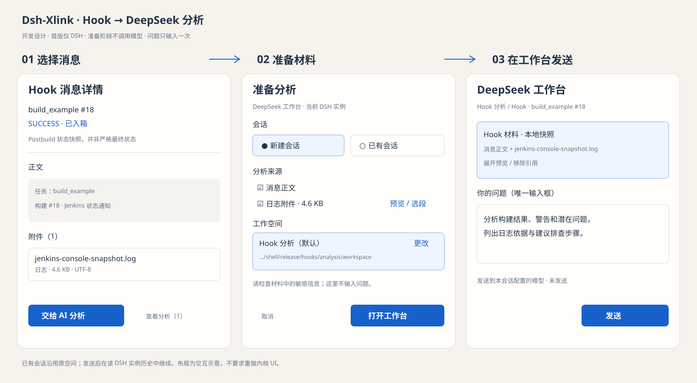
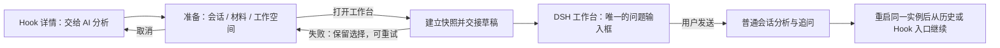

# Hook → DeepSeek 分析：开发设计与验收合同

日期：2026-11-18 · 状态：设计提案 / 待开发 · 基线：`5e08b5d1`（0.7.6-rc.5）

> 本 PR 只增加设计文档与交互图，不实现产品功能，不代表内核接口、会话恢复或模型分析已通过验收。图、本文与验收表共同作为开发输入；实现证据另记，不将设计描述改写成“已支持”。

## 1. 目标与已确定范围

用户在 Hook 详情选择正文与日志，交给 DeepSeek 工作台分析，并能继续在普通会话中追问、重启后找回历史。

- **首版仅 DeepSeek Harness（DSH）内核**。没有内核选择器，不提供 MiniMax 入口或占位项；MiniMax 等官方稳定版 Web UI 后另立任务。
- 面向新功能设计，不提供复制粘贴临时方案，不为旧版本工具补兼容流程。
- **只保留一个问题输入框**：准备页没有“分析指令”，问题只在工作台编辑。
- 用户点击“打开工作台”只准备草稿，点击工作台“发送”才提交模型。Hook 到达、打开详情、生成快照、启动内核均不能自动调用模型。
- 现有 Hook 接收、入箱、预览语义不变。局域网广播 / 自动配对想法继续搁置，本功能不涉及该能力。
- 首版材料为正文与文本日志。图片附件显示为“本期不支持分析”，不可选；不做 OCR、外部 URL 抓取、构建重跑、自动修复、结果自动回发 Jenkins。
- DeepSeek 是内核，不是强制指定模型供应商：使用该会话当前配置的模型，不自动切换模型、账号或权限。

## 2. 产品决定与术语

| 术语 | 本设计含义 |
| --- | --- |
| Hook 事件 | 收件箱原始通知；入箱不等于已审核或允许外发 |
| 工作空间 | DSH 会话的工作目录上下文，不是会话历史数据库 |
| 分析材料包 | 用户选择的正文/日志的独立、不可变本地快照 |
| 分析交接 | 把材料包绑定到指定 DSH 实例、工作空间与会话草稿 |
| 发送 | 用户在工作台提交问题和引用；唯一允许模型调用的动作 |

下面的默认目录、保留规则与限额是本 PR 的产品提案，并非当前实现事实。合并设计后以此实施；若内核能力验证发现关键阻塞，先更新设计，不能靠改内核或后台自动发送绕过。

## 3. 交互与视觉

[三步 UI 交互图](analysis-ui.svg)为本版规范图。此前带 MiniMax 选项、两个问题输入框的概念图片已作废。





### 3.1 消息详情

- 在底部增加主按钮“交给 AI 分析”，不把它放在“永久删除”旁边作为同色动作。
- 仅 `ready` 且至少有正文或可读日志时可用。接收中、已清理、损坏等状态展示具体原因，不创建半材料包。
- 头部显示任务名、构建号、来源及状态。保留“Postbuild 状态快照，非严格最终状态”等原始限定，不将 SUCCESS 快照推断为最终结果。
- 若已有交接记录，显示“查看分析（N）”；列表显示会话标题、时间、实例、草稿/已发送/不可用。再次分析是显式新动作，不静默重复发送。

### 3.2 准备页

| 区域 | 默认与行为 |
| --- | --- |
| 标题 | 准备分析；副标题“选择会话、材料与工作空间” |
| 内核 | 静态标识“DeepSeek 工作台”，无内核选择器 |
| 会话 | 默认“新建会话”；切换“已有会话”后必须选定具体会话 |
| 实例 | 解析当前壳的 DSH 默认实例并显示标签；本次交接固定该实例，不读 MiniMax 页面选择 |
| 分析来源 | 正文默认勾选；每个支持的日志单独勾选，默认勾选符合限额的日志；显示名称、大小、完整/选段；至少一项 |
| 工作空间 | 新建：默认“Hook 分析”，显示可复制绝对路径与“更改”；已有：显示原工作空间、只读，不悄悄移动会话 |
| 材料检查 | 支持预览、取消勾选、对日志选择行段；不重复提供问题输入框 |
| 页脚 | “取消”与“打开工作台”；准备中防重复点击，错误保留全部选择 |

选已有会话时只列本次 DSH 实例当前可访问的会话，显示标题、工作空间和更新时间。正在生成回复的会话不可交接，提示等待或新建；不能打断当前任务。切换已有/新建保留各自选择，不能用新建空间覆盖已有空间。

### 3.3 工作台

- 打开选定会话，加入可展开的“Hook 材料”引用卡，展示来源、快照时间、附件和选段范围。
- **只有此处有“你的问题”输入框**。新建会话预填可编辑建议：“分析这次构建的结果、警告和潜在问题，列出日志依据与建议排查步骤。”已有草稿不覆盖、不自动拼接新问题。
- 用户可删掉引用、编辑问题后发送。问题为空时不发送，显示“请输入分析问题”。
- 草稿已有内容时，保留原文，追加材料引用；若内核不支持安全追加，不覆盖，提示“该会话已有草稿，请处理后重试或新建会话”。
- 发送按钮附近明确“发送到当前会话配置的模型”；展示实际模型/供应商，不声称在本地分析。模型未配置时保留草稿并引导现有设置。
- 分析结果留在 DSH 普通会话。Hook 面板只维护关联，不复制成第二套 AI 聊天记录。
- 无障碍：Tab 可达全部控件；Space 可切换材料；Escape 返回准备/详情且不发送；焦点恢复到触发按钮；长路径、长标题可换行或复制，底部动作始终可达。

## 4. 工作空间、目录与历史

### 4.1 默认工作空间

为避免 dev / release 共用可变材料，修订概念图中未分壳模式的简化路径。首版默认：

```text
<DSH_XLINK_HOME>/shell/<release|dev>/hooks/analysis/workspace/
```

Windows 默认 release 示例：

```text
%USERPROFILE%\.dsh-xlink\shell\release\hooks\analysis\workspace
```

这是**新功能拟新增路径**。所有路径由后端 `paths::*` 解析，遵循 `DSH_XLINK_HOME`，前端不能拼用户目录或硬编码实例 ID。首次“打开工作台”才创建；只打开准备页/取消不创建目录。

这是一个统一工作空间中的多个独立会话，不是把所有通知写入同一个对话。新建标题为 `Hook · <事件标题>`，去除控制字符并限制显示长度；保存事件 ID 映射，不靠标题匹配会话。

“更改”仅更改本次新会话的工作空间，可选择项目目录；不改实例默认 cwd、不重启/迁移已有会话、不更改全局默认实例。目录不可用或不可写时在准备页报错，不回退到用户项目根目录。选择已有会话时沿用其空间。

**关键能力门禁**：现有实例 cwd 和 DSH 会话级 workspace 不是同一概念。必须证明 DSH 支持在不改变实例 cwd 的情况下创建/打开指定 workspace 会话。若不支持，不能用修改实例 workspace 或自动创建另一个实例来冒充达成；停在阶段 A，提交修订方案。

### 4.2 会话历史与草稿

- 会话历史由所选 DSH 实例原生存储管理。当前架构中该数据在实例 `home/sessions` / `home/storages`，不在本设计的材料目录。壳不能直接写原生会话文件。
- 同一实例、同一 profile 重启后，已发送会话必须仍可在 DSH 工作台的对应工作空间历史中找到并继续；不是只在 Hook 页面留一条链接。
- 壳保存 `instance + profile + workspace + session_id` 关联；会话被删除、实例被卸载或 profile 不匹配时显示“原会话不可用”，不静默换实例/新建会话。
- 交接后未发送的材料草稿也保留交接记录。重启后可从“查看分析”选择恢复；恢复只重建未发送引用，不自动调用模型。用户发送前自行编辑的问题由内核草稿能力承担，不宣称已持久化，必须通过阶段 A 验证并在 UI 披露实际行为。
- 新建后取消/关闭工作台，允许保留一个原生空会话；复用同一交接 ID 恢复，不批量生成空会话。

### 4.3 材料快照与生命周期

```text
shell/<mode>/hooks/analysis/
├── workspace/                  默认分析工作空间
├── packages/<handoff_id>/       manifest.json + 所选正文/日志快照
└── handoffs.json                交接状态和原生会话关联，不含凭据
```

材料包独立于 Hook 收件箱的容量清理。入箱历史清理/删除不得破坏已建立的分析会话引用；删除 Hook 原事件时提示“已交给分析的副本和会话不会一并删除”。不自动删除会话，也不把分析材料副本计入原收件箱 5 GiB 后静默驱逐。

- 后端通过事件 ID / 附件 ID 查权威记录，读取期间持有与清理协调的短租约或等价读锁；核对状态、长度与 SHA-256。不能只复制 UI 当前日志预览页。
- 在同盘临时目录完成包，校验成功后原子发布。崩溃残留只清理本模块带归属标记的未发布临时包；已发布包不自动过期。
- 首版建议每次选中正文及日志合计上限 **1 MiB UTF-8 文本**，独立快照总预算 **1 GiB**。两者是资源上限，不是模型 token 容量保证。超限阻止继续，提示选择行段/减少附件；绝不静默截断。
- 模型输入容量还需按当前模型与已有会话上下文预检；无法准确估算时显示未知，尊重内核的发送限制，不承诺任意模型能接收 1 MiB。
- 快照满额提供“管理分析材料”，展示包大小、关联会话及删除影响。删除需要用户明确确认，只清理选定材料包与相应壳侧关联，内核会话由工作台管理。会话内保留缺失提示，不能恢复读取已经删除的原文件。
- 没有从工作目录直接赋予模型任意读权限。引用只展开本次选中的快照；新会话默认空间里即使存在其他文件，也不自动附加。
- 日志选段记录原始行号、原文件哈希与“非完整日志”，模型侧保留这些限定。文件名只作展示，存储文件名由内部 ID 生成。

## 5. 数据与跨窗口交接合同（拟新增）

以下是语义合同，不是现成 API 名称；阶段 A 落地时定义单一 DTO 来源与错误码，避免前后端手抄两套。

### 5.1 交接对象

```text
handoff_id / schema_version / created_at
source: event_id + source_label + title + received_at
target: family=dsh + instance_id + profile + workspace + session_id?
materials[]: kind + internal_id + display_name + sha256 + bytes + line_range?
state: prepared | attached | sent | failed | unavailable
failure: code + user_message (不含正文/凭据)
```

- UI 传选择和请求 ID，不传任意磁盘读取路径；后端解析目标、读取权威材料并验证。
- `prepared` 表示包已持久化；`attached` 只能在目标工作台确认正确会话中存在引用后写；`sent` 只能依据内核真实发送事件，不凭按钮点击/窗口打开判断。
- 重复点击与响应丢失使用同一请求 ID，返回同一交接/会话，不重复注入或发送。用户选择“再次分析”才新建请求 ID。
- 交接确认至少绑定 `handoff_id + instance_id + profile + workspace + session_id`；迟到响应不能写到后来切换的会话中。
- 草稿删除引用不删除共享快照；“恢复”必须检查当前草稿是否已含该引用，禁止重复。
- 后端错误：材料不可用、超限、目标不可用、工作区不可用、能力不支持、草稿冲突、交接超时、存储失败。UI 原地保留选择并给出具体重试动作，不能报“分析成功”。

### 5.2 架构边界

1. `ui/src/hooks/` 负责准备交互，经 store → `ui/src/shell/bridge.js` → Rust；不在 Vue 中直接访问内核或磁盘。
2. Hook 后端保持接收独立。新增本地处理模块负责材料包、租约、映射和目标校验。没有公网/LAN 模型执行 API，不复用 Hook Bearer 令牌给内核。
3. 壳通过自有 DSH 插件与已验证的原生扩展点完成工作空间/会话与引用交接。仅扩大本功能需要的本地桥能力，绑定实例并鉴权，不接受任意来源路径。
4. 所有模型调用和普通会话存储仍由 DSH 管理；不改安装目录 `node_modules`，不直接写 `sessions` / `storages`，不依赖上游未来修复。
5. 使用现有输入引用机制作为设计先例，但不能把 `openSession` 当成提交接口，也不能用 DOM 草稿恢复脚本模拟可靠消息 API。

### 5.3 已核实与待验证

| 项目 | 基线事实 / 下一步 |
| --- | --- |
| HookDetail / hooks store | 已有正文、附件预览和分页，没有 AI 分析入口 |
| shell-navigation 插件 | 有打开已有会话的导航先例，不证明创建指定工作空间会话 |
| official-chat 插件 | 有输入引用设计先例，不是可直接复用的 Hook 发送端 |
| 实例工作空间与会话 home | 分离，见磁盘布局；目录存在不证明重启后 UI 恢复 |
| 指定 workspace 新建 / 列举会话、追加引用、发送回执、草稿恢复 | **待阶段 A 对实际 DSH 包验证**，不能凭 mock 通过判定可用 |

源码入口：[HookDetail](../../../ui/src/hooks/HookDetail.vue)、[hooks store](../../../ui/src/hooks/hooks.js)、[会话导航](../../../plugins/shell-navigation/client/client.js)、[引用先例](../../../plugins/official-chat/client/client.js)。

## 6. 内容与权限

- 日志/正文是外部资料，不是用户指令或工具授权。模型输入以独立引用标明来源；其中“删除文件/执行脚本/打开 URL”等不能因为被引用就自动获得授权。
- 首版分析只要求解释、证据与建议，不授予新增自动执行权限。保留内核原有工具审批，不能静默提升权限；提示词不是完整沙箱或防注入保证。
- 接收同意与模型发送同意分开；准备页可预览材料，最终发送前展示所选模型和范围，不自动脱敏、不声称无敏感信息。
- 不把 Hook 接入令牌、模型凭据、浏览器会话、任意机器路径内容打入材料。日志中真实存在的敏感信息可被用户排除或选段，外发前提醒。
- 遥测和错误日志记录 ID、字节数、状态、错误类型，不记录完整正文、附件或凭据。
- 支持内核关闭时通过既有受管启动流程启动 DSH，启动本身不调用模型；失败保留材料选择和错误，不能切换到其他内核。

## 7. 开发顺序与完成门槛

| 阶段 | 交付 | 通过条件 |
| --- | --- | --- |
| A：最小真实内核探针 | 精确 DSH 版本/包摘要、原生 workspace/session/reference 契约、草稿和发送事件证据 | 在隔离 home 验证新建/已有会话、草稿不外发、同实例重启找回；接口不支持则先修订设计 |
| B：材料与状态 | 路径解析、原子包、配额、清理协调、交接记录及本地鉴权 | 单测覆盖并发清理、半包、超限、重复 ID、跨实例拒绝 |
| C：准备 UI 与桥 | 详情入口、单内核准备页、材料选择与路径、原生草稿引用 | UI/插件定向测试及真实工作台交接，旧草稿不覆盖 |
| D：完整验收 | Windows / Intel macOS 同一候选提交的证据 | 下表必需项通过；未做记录 not_run，不以 CI 或模型桩替代实机结论 |

测试必须遵循[开发验证](../../operations/development.md)，使用临时 home、独立端口、独立浏览器档案与通道，不访问真实个人会话。变更内置插件后重新物化/构建/重启并校验摘要。日常跑命中测试及仓库要求的定向门禁；发布前才执行全量门禁，本设计 PR 不发布版本。

## 8. 验收矩阵

每条证据记录 commit、应用/DSH 版本、OS、隔离根、步骤、实际结果、pass / fail / not_run。模型桩用于观察请求与防重复；最终另用合成无敏感材料和真实模型完成最小分析链路。

| ID | 操作 / 场景 | 可观察通过标准 |
| --- | --- | --- |
| A01 | 打开准备页 | 仅 DeepSeek 标识；无 MiniMax/内核选择器；无分析指令输入 |
| A02 | 正文 + 4.6 KB 多页日志 | 完整快照与原文件哈希对应；不是只读预览第一页；可取消任一项 |
| A03 | 新建会话默认/更改空间 | 路径可见；指定空间中出现新会话；原实例 cwd 和全局默认不变 |
| A04 | 已有会话 | 原空间不变；只选择当前 DSH 实例的会话；原消息与草稿不丢失 |
| A05 | 打开工作台 / 返回 / 取消 | 模型请求数为 0；返回选择不丢失；未点击打开不创建包 |
| A06 | 编辑唯一问题并发送 | 所选正文/日志准确进入一次请求；未选材料不出现；回复进入正确会话 |
| A07 | 关闭工作台并重启壳/内核 | 同一实例/profile/workspace 历史可见，能继续追问；Hook 关联可重开 |
| A08 | 未发送引用重启恢复 | 可恢复同一交接且请求数仍为 0；不生成重复空会话；草稿问题恢复行为与 UI 披露一致 |
| A09 | 双击、超时重试、迟到 ACK | 同一请求只建一个包/会话/引用；迟到响应不污染新选择的会话 |
| A10 | 已有草稿 / 正在生成 | 不覆盖、不打断；冲突提示可操作；切换新建后可继续 |
| A11 | 内核未启动、启动失败、模型未配置 | 正确引导并保留选择/草稿；无假成功、不静默换内核 |
| A12 | Hook 删除/容量清理与快照并发 | 要么完整建包，要么明确失败；已发布快照仍可分析；原事件删除不删会话 |
| A13 | 1 MiB 输入/1 GiB 总预算边界 | 上限内成功，超限明确拒绝；选段标记准确；没有静默截断 |
| A14 | 磁盘满、只读目录、崩溃半包 | 不发布半包；重启可识别残留；只清自己未发布临时文件 |
| A15 | 日志含指令、URL、路径穿越文件名 | 作为资料展示/引用；不因入箱或准备执行工具、不抓取 URL、不越界读写 |
| A16 | 删除/切换实例、会话已删除 | 显示原目标不可用，不把材料投给其他实例/新会话 |
| A17 | dev/release、两个 DSH 实例 | 材料包/交接记录隔离，目标绑定正确，不共享凭据 |
| A18 | 图片、缺失附件、超大日志、乱码 | 不支持项说明且不可选；不可读材料不伪装成功；选段后可重试 |
| A19 | 小窗、长标题、键盘、亮暗主题 | 无横向遮挡，主要操作可达，焦点与返回一致 |
| A20 | 真实模型最小链路 | 用合成日志返回引用依据，SUCCESS 快照不被界面标成最终状态；不把回答质量代替传输正确性 |

## 9. 回退与交付

- 功能模块可停用而不影响现有 Hook 入箱、预览和 DSH 普通聊天。
- 停用后不再创建新交接，不删除已发送会话或材料；已有引用应能读取，做不到时明确提示而非悬空失败。
- 不自动降级到复制粘贴、不自动改内核文件；能力不支持则入口显示具体原因。
- 实现 PR 要附本矩阵状态和证据链接、实际支持的 DSH 版本、路径/限额变更及剩余风险；不得把本设计的待验证项直接打勾。
- 此文不改变[Hook 入箱合同](lan-inbox-design.md)；后续处理遵循其“素材入箱与模型授权分离”的边界。默认专用 workspace、快照保留与显式发送是本次产品取舍，避免将其泛化成通用工作流引擎。
