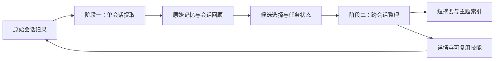

# Codex 离线记忆系统分析

日期：2026-10-13。对象：本机 Codex 桌面应用的安装产物和本地记忆存储。配套：[dsh-xlink 本地记忆系统设计](dsh-xlink-memory-design.md)。本文是静态调查报告，不是生成流程的运行验收。

## 1. 结论与范围

Codex 的本地记忆可以理解为两个相互配合的面：SQLite 管理会话提取结果、任务租约、处理水位和使用统计；Markdown 提供智能体可以逐层阅读的知识。生成分成“单会话提取”和“跨会话整理”两个阶段，读取则从短摘要进入索引，再按需展开详情。

这个设计最值得借鉴的是：允许无价值会话不产生记忆、保留来源、限制每次读取量，以及把原始执行记录与可复用知识分开。没有证据足以把本机机制称为向量数据库检索，也不能把“存储在本机”称为“生成过程完全不联网”。

本文只分析本地会话记忆。ChatGPT 云端 saved memories、跨设备同步、远程托管任务，以及屏幕历史采集的具体流程均不展开。桌面包同时包含这些功能，文件名含 `memory` 不能单独证明它属于离线会话记忆。

“离线”在这里指记忆文件、状态和检索可以留在本机。Codex 原有模型提取是否请求远端，本次没有触发或抓取；若要求断网也能生成新记忆，还需要本地模型或确定性的人工保存流程。

## 2. 样本与证据口径

### 2.1 安装产物

| 项目 | 本次样本 |
| --- | --- |
| 应用位置 | `/Applications/ChatGPT.app` |
| 包标识 | `com.openai.codex` |
| 显示版本 / 构建号 | `26.1007.30912` / `20156` |
| Electron 归档 | `Contents/Resources/app.asar`，567,757,575 字节 |
| 归档 SHA-256（安全哈希算法 256 位） | `c5b273322a833ce5165429d468021cc6289a11cc68d075b80ae773bd7fb6731f` |
| 桌面自带 CLI（命令行工具） | `Contents/Resources/codex-cli/CodexCLI.app/Contents/MacOS/codex` |
| 自带 CLI 版本 | `0.162.0-alpha.17.2` |
| 自带 CLI SHA-256 | `13c90fa898602a5f165da3b61265142d3a2bfb77786def29a313d3a3756b88d0` |

系统另装的 Codex CLI 不是本报告的主样本。安装包的应用名与包标识不一致，因此记录实际路径和标识，而不假定一定存在 `/Applications/Codex.app`。

### 2.2 证据类型

| 标记 | 含义 | 能支持的结论 |
| --- | --- | --- |
| A | 哈希校验后的安装包 JavaScript 静态代码 | 数据路径、配置映射、调用构造；不能证明运行到达 |
| B | 桌面自带原生二进制中的模板、配置键和 SQL（结构化查询语言） | 产品携带的规则及查询；不能替代原生控制流反编译 |
| C | 本机目录与 SQLite 只读模式、汇总统计 | 这个用户目录中确实存在什么；不代表全部版本的默认行为 |
| D | 官方说明 | 辅助解释；不能覆盖本机版本证据 |

REA（Reverse Engineer Anything，逆向分析工具）6.4.0 的完整归档分析因一个 unpacked 原生扩展的声明摘要与实文件不一致而停止。失败对象是 `node_modules/@worklouder/device-kit-oai/node_modules/@worklouder/wl-device-kit/dist/native/darwin/permissions.node`。签名或打包后处理可能造成这种情况，但本次没有验证原因，也没有忽略校验继续信任该扩展。

随后只从归档取出相关模块，每个模块的实测 SHA-256 均与归档声明一致，再进行限定分析。REA 记录为：

`ev_43ebd25a65da92dcb1d7e4c8cf88e8b3e863e7f7ad2761624c1378fc9a331a87`

其目标是五文件子集，不是整个应用：4 个 JavaScript 文件加 `package.json`，共 5,439,181 字节，未报告语法解析失败。两个大 bundle 在语义分析阶段达到 768 MiB 堆限制，图覆盖不完整。因此本文的记忆行为结论主要来自下面列出的具体代码片段、二进制模板和本机模式，不能宣称 REA 已恢复完整记忆调用链。[证据清单](codex-offline-memory-evidence.json)保留样本身份、定位锚点与这些限制；它不是完整 REA Evidence 的替代品。

## 3. 本地数据如何组织

本机观察到的结构如下，省略与记忆无关的文件：

```text
<CODEX_HOME>/
├── sessions/.../*.jsonl            原始会话执行记录
├── state_5.sqlite                 会话状态，threads 含 memory_mode
├── memories_1.sqlite              一版记忆处理状态
├── memories_v2_1.sqlite            另一版记忆处理状态
└── memories/
    ├── memory_summary.md          常驻短摘要，模板规定首行 v1
    ├── MEMORY.md                  可检索的主题索引与知识
    ├── raw_memories.md            第一阶段结果的合并输入
    ├── rollout_summaries/*.md     蒸馏后的会话回顾
    ├── skills/*/SKILL.md           可复用操作流程
    └── extensions/ad_hoc/notes/   用户显式添加的材料
```

JSONL（按行分隔的 JSON）原始执行记录与 `rollout_summaries/*.md` 是两类文件。本机后者确实是普通 Markdown，而不是 JSONL。不能因为一段通用提示这样描述它，就忽略实际格式。

这次目录快照中，短摘要为 6,982 字节，索引为 63,850 字节，合并输入为 79,096 字节，详细回顾有 16 份。数字只用来说明“常驻摘要显著小于知识索引”，不作为产品大小限制。没有把用户正文、会话内容或数据库复制进本仓库。

两版数据库同时存在，且桌面代码携带 `memories.version` / `memories.dual_write` 配置映射。这支持“存在版本化和双写能力”的观察；不能据此判断当前所有会话使用哪版，也不能把两库简单拼起来当作两份独立记忆。

## 4. 写入：先提取，再整理



末端指回原始记录表示来源追溯，不表示改写原始记录。这张图根据 B/C 证据重建职责关系，不是已运行的时序跟踪。

### 4.1 阶段一：从一个会话得到候选知识

桌面自带二进制携带 `Memory Writing Agent: Phase 1 (Single Rollout)` 模板，要求输出 `rollout_summary`、`rollout_slug`、`raw_memory`。它对输入与输出的区分很清楚：

- 原始记录保持不变；网页、工具结果和其他第三方文本是数据，不能成为新的执行指令。
- 优先保存用户纠正、重复出现的偏好、经验证的步骤、失败原因和避免重犯的方法。
- 保留任务结果与验证范围，不得把未验证方案写成成功经验。
- 凭据替换成 `[REDACTED_SECRET]`。
- 没有持久价值时允许三个字段全空，不为每个会话硬凑一条记忆。

这更接近“提炼以后能用的经验”，而非普通聊天摘要。一个会话中的临时计划、复制的外部文章和最终确认的工作习惯，保存价值和信任程度不同。

### 4.2 SQLite 的控制面

两版数据库都有 `stage1_outputs` 表。关键字段为：

| 字段 | 表达的状态 |
| --- | --- |
| `thread_id` | 单会话提取结果的主键 |
| `source_updated_at` / `generated_at` | 来源版本与生成时间 |
| `raw_memory` / `rollout_summary` / `rollout_slug` | 提取产物 |
| `usage_count` / `last_usage` | 使用反馈 |
| `selected_for_phase2` / `selected_for_phase2_source_updated_at` | 是否进入整理及当时来源版本 |

`jobs` 表以 `(kind, job_key)` 为主键，并记录 `worker_id`、`ownership_token`、`lease_until`、`retry_at`、`retry_remaining`、输入与成功水位。二进制内的 SQL 显示：租约仍有效的 running 任务不能随意接管；失败回写必须同时匹配 running 状态和所有权令牌；重试次数递减。更新单会话产物时，还比较来源更新时间，避免旧输入覆盖新结果。

这是崩溃恢复和并发控制的证据，不只是“有一个缓存表”。不过，本次没有实际终止生成任务来验收接管行为。

### 4.3 阶段二：把候选整理成可读知识

`Memory Writing Agent: Phase 2 (Consolidation)` 模板明确规定渐进读取的本地目录：短摘要负责路由，`MEMORY.md` 聚合主题与详情指针，回顾保留具体证据，技能保留值得重复执行的流程。`raw_memories.md` 是第一阶段结果的合并输入，不是智能体每轮必读的终稿。

候选 SQL 排除原始记忆和回顾都为空的结果，按最近使用时间判断保留窗口，没有使用时间时使用来源更新时间。排序优先使用次数，再看最近使用或来源时间、来源更新时间和线程 ID，最后以 `LIMIT` / `OFFSET` 控制批次。

因此，“常被使用的经验优先保留”有查询证据；具体保留多少天、批次多大、每次启动处理几个会话，本次没有确认数值默认值。

## 5. 读取：把小摘要当入口

二进制内的检索指导与阶段二模板共同支持下面的路径：

1. 新任务先看已注入的短摘要，决定历史经验是否相关。
2. 从摘要提取模块、路径、错误和技术名词，在 `MEMORY.md` 做关键词检索。
3. 只打开命中的 1–2 份详细回顾或技能。
4. 需要精确错误、命令或验证过程时，再沿 `rollout_path` 找原始记录。
5. 没有相关结果就停止，不为了用记忆而扩大搜索。

这是一种由智能体判断相关性的文件检索流程。模板要求常驻摘要进入系统提示，但单凭模板不能证明每个桌面会话、每个实验配置都启用它。

桌面主 bundle 中还有一个 `readSummary()` 实现，读取执行主机的 `<CODEX_HOME>/memories/memory_summary.md`，空文件或读取异常时返回 `null`。其构造点位于语音相关装配附近，只能证明桌面存在这个摘要消费者，不能拿它解释全部会话的提示注入。

另一个 bundle 构造线程参数时映射 `generateMemories` / `useMemories` 到 `memories.generate_memories` / `memories.use_memories`，并映射版本与双写选项。它说明读和写是独立配置，不应把“启用读取”等同于“自动生成”。

使用反馈也有具体 SQL：递增 `usage_count`，更新 `last_usage`。本次未定位所有反馈调用点，不能断言每次读文件都算一次有效使用。

## 6. 哪些是确认的，哪些仍未知

| 问题 | 结论 | 证据 / 边界 |
| --- | --- | --- |
| 是否有本地持久化 | 确认 | C：文件和两版 SQLite 模式 |
| 是否分两阶段生成 | 静态强证据 | B：两个模板、第一阶段表、第二阶段候选 SQL |
| 是否渐进读取 | 静态强证据 | B：常驻摘要、关键词索引、详情与来源追溯规则 |
| 是否支持不生成记忆 | 确认规则存在 | B：阶段一的三空字段分支；未触发运行 |
| 是否有租约、重试和防旧写覆盖 | 确认相关模式和 SQL 存在 | B/C；未做故障注入验收 |
| 是否有使用与时间驱动筛选 | 确认 SQL 存在 | B；反馈调用范围未知 |
| 当前所有桌面任务是否启用 | 未确认 | A 中有配置与功能控制；未追踪每个分支 |
| 是否必须向量检索 | 无法建立这个主张 | 观察到文件关键词流程；不能排除未覆盖功能 |
| 哪版数据库为当前权威 | 未确认 | 两库并存、配置有版本和双写；切换策略未恢复 |
| 提取是否完全不联网 | 未确认，也不应这样宣传 | 存在模型选择和额度门槛参数；未调用模型 |
| 删除是否清理所有衍生材料 | 未确认 | 本次未执行删除或重新整理 |
| 摘要与索引能否事务性一起发布 | 未确认 | 有任务状态和文件；未恢复文件发布控制流 |

官方 OpenAI Docs 对 Sandbox Agents（沙盒智能体）的说明也采用两阶段生成和渐进文件读取。这是另一产品接口的辅助印证，不是证明桌面与它使用同一实现，更不能把该说明中的“会话关闭触发”直接套到这个桌面版本。[官方说明](https://developers.openai.com/api/docs/guides/agents/sandboxes)

## 7. 对 dsh-xlink 的启示

| 值得沿用 | dsh-xlink 的具体做法 |
| --- | --- |
| 短摘要先行 | 只注入当前项目和用户批准的偏好，不注入所有历史 |
| 阅读面与控制面分离 | Rust 管权威记录和任务状态，Markdown 做可检查的衍生视图 |
| 单会话提取后再合并 | 先产生候选；确认后确定性生成索引，不让模型任意重写全库 |
| 保留来源和验证范围 | 每条记忆绑定会话、事件范围、来源版本及验证状态 |
| 无价值时不写 | 空提取是正常结果，不算故障 |
| 使用反馈 | 区分“被展示”和“确实引用”，不直接把曝光次数当质量 |
| 可恢复任务 | 有界队列、租约、版本比较和取消，不阻塞用户对话 |

不照搬 Codex 的全局目录、未知的双写机制或默认参数。dsh-xlink 已有实例、壳模式和内核族隔离，需要把这些边界带进记忆权限；它的工作台也已有动态上下文装配，应该接这个入口，而不是修改内核安装树或追加一份无限增长的提示文件。具体接口与分阶段验收见[设计文档](dsh-xlink-memory-design.md)。

## 8. 调查完成度

本地布局、阶段职责、读取策略、来源关联和任务控制字段已经得到对应证据；桌面配置映射与 dsh 接入合同也已核对。原生运行控制流、数值默认值、数据库版本切换、删除后衍生内容清理和真实模型调用仍未验证。

本次没有启动新的目标应用、生成或删除用户记忆、改动真实会话、读取凭据或研究联网同步。完整的运行验收应使用合成会话和独立临时数据根，不能在用户现有记忆目录上做故障实验。
