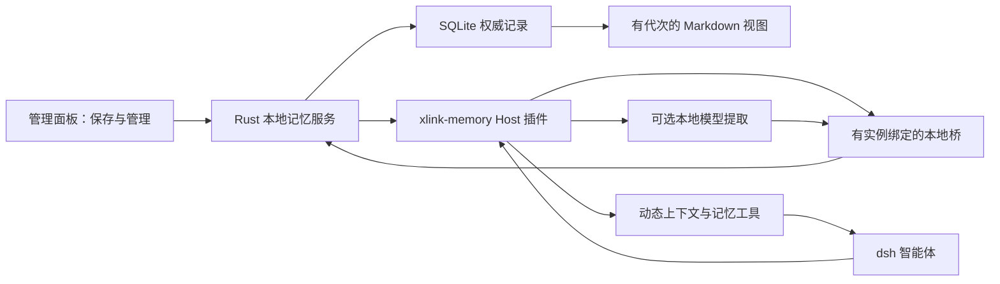

# dsh-xlink 本地记忆系统设计

日期：2026-10-13。状态：设计提案，尚未实现。依据：[Codex 离线记忆系统分析](codex-offline-memory-analysis.md)。本次只新增设计文档，不改变工作台行为。

## 1. 目标与交付边界

用户在 dsh 工作台完成任务后，可以保存长期有效的偏好、项目决策和已验证的解决方法。后续在同一个项目继续工作时，智能体自动得到一份有界、带来源的相关记忆；用户能查看、纠正、停用和删除它。

首版交付“明确保存 + 自动检索”：保存无需额外模型请求；检索与排序在本机完成。自动从会话提炼候选是后续阶段，只接经过验证的本地模型，不自动回退到远端模型。云同步、跨设备账号记忆、屏幕采集、自动生成技能、向量服务均不在本设计范围。

本地记忆不会自行同步到服务端。但用户若在普通对话中选择远端模型，随请求注入的记忆也会成为该模型的输入。启用页须说明这一点；“记忆本地保存”不能解释为“对话上下文永不出网”。要求全程断网时，对话与候选提取都必须使用可离线运行的模型；当前设计不承诺 dsh 已自带这种模型。

### 1.1 关键取舍

| 选择 | 原因 |
| --- | --- |
| 随壳交付内置 Host（宿主侧）插件 `xlink-memory` | 使用 dsh 的正式扩展面，避免侵入官方内核 |
| Rust 是记忆数据的唯一写入方 | 管理面板、模型工具和后台任务有一致的隔离、版本及删除规则 |
| SQLite 为权威记录，Markdown 为衍生视图 | 保证候选审批、版本提交和任务领取的事务一致性，同时方便用户检查 |
| 按当前项目检索，用户偏好需明确批准 | 不把 A 项目的业务信息自动带到 B 项目 |
| 自动提取只形成候选 | 模型总结和第三方文字不能自行成为长期规则 |
| 复用动态运行上下文 | 不修改项目 `AGENTS.md`，不把记忆冒充最高优先级系统指令 |

仓库目前的 `src-tauri/Cargo.toml` 没有直接 SQLite 依赖。实施时需要登记一个 SQLite 访问依赖并验证打包；这是为事务和跨进程并发付出的明确成本，不是已经存在的基础设施。首版不再引入独立索引进程或全文检索服务。

## 2. 用户如何使用

管理面板增加“记忆”入口，沿用现有 Element Plus 列表、搜索、详情与确认交互。进入后默认是当前项目，另外提供“此实例的通用偏好”和“待确认”视图。页面必须标明“设计实施后才可用”，本文不能作为已上线功能说明。

首版支持以下操作：

- 新建或编辑一条记忆，选择当前项目或通用偏好；明确显示最后修改时间、来源和验证状态。
- 在工作台要求“记住这条约定”时，智能体通过 `memory_propose` 生成候选卡片，用户点“保存”即可；不需要再次运行整轮对话。
- 下次任务自动检索已接受的记忆，工作台显示“本次使用了 N 条记忆”，点开能看到具体内容和来源。
- 停用项目记忆完成后，新开始的回合不再新增记忆贡献；已准备或正在发送的请求不能撤回，已保存在当前会话中的旧快照仍可能出现在请求历史里。
- 删除前显示影响范围；删除后阻止再次检索及相同来源自动重建，保留用户选择处理会话历史的入口。

“手工保存”可以直接从管理面板完成。模型工具只有搜索、读取和提出候选的能力，不能修改开关、批准自己的候选、跨项目推广偏好或执行清空。

启用开关分开保存：使用已批准记忆默认关闭，自动提取也默认关闭。首版启用前者即可工作；后者未通过本地模型验收时显示不可用及原因，不能用同一个“已开启”掩盖缺失能力。

## 3. 已核对的 dsh 接入合同

本机 release 的 `active.txt` 为 `0.2.1-alpha.2`。本节核对这个安装包的源码和类型；没有启动真实工作台或调用模型。下表路径均相对于该版本的 `node_modules/@deepseek-ai/`，行号属于本次样本。

| 接入点 | 包文件与行号 | 本次确认的行为 |
| --- | --- | --- |
| 动态上下文 | `dsh-system-prompt/lib/types/index.d.ts:72–85,263–266` | `ctx.systemPrompt.context()` 注册命名贡献，可按 agent scope（智能体作用域）隔离，文本提供方同步执行 |
| 请求前刷新 | `dsh-system-prompt/lib/types/index.d.ts:292–301`；`dsh-agent-loop/lib/index.js:1053–1073` | 请求 admission（准入）时刷新注册的运行上下文，再提交 user-role 快照 |
| 首步钩子 | `dsh-agent/lib/types/runtime-types.d.ts:294–310`；`dsh-agent-loop/lib/index.js:902–924` | `agent/pre-step` 是可替换 messages 的 waterfall（逐层返回结果的拦截链）；必须保留 `next()` 的决定 |
| inject 时序 | `dsh-agent-loop/lib/index.js:812–813,906–909` | inbox 已领取后才进 pre-step；此时 `agent.inject()` 的内容留到下一步 |
| 快照去重 | `dsh-agent-loop/lib/index.js:298–355` | 同文本不产生新运行上下文；压缩移除原快照后可重新生成；改变内容仍会形成新的历史消息 |
| 初始化 | `dsh-agent/lib/types/runtime-types.d.ts:214–230` | `agent/created` 可按 `startup/resume/clear/compact` 建立 agent-local 注册并随销毁卸载 |
| 回合日志 | `dsh-session/lib/types/index.d.ts:51–69`；`dsh-agent-loop/lib/index.js:1027–1035` | `session/event` 是提交后的观察通知，可筛选 `turn/end` |
| 持久化屏障 | `dsh-session/lib/types/types.d.ts:265–275` | 回合结束不自动 flush（刷入持久化存储）；读取盘上记录前需 `ctx.sessions.flush(session)` |
| 项目身份 | `dsh-session/lib/types/index.d.ts:143–150`；`dsh-workspace/lib/types/types.d.ts:9–13,57–65` | session.header 的 cwd（工作目录）是冻结元数据；工作区路径经 realpath，ID 是 UUID（通用唯一标识符） |
| 工具注册 | `dsh-tools/lib/types/index.d.ts:115–128,631–655` | `ctx.tools.register()`，需输出模式和执行函数；调用 agent 可缺失，项目读写必须拒绝这种情况 |
| 记录读取 | `dsh-session-persistence/lib/types/index.d.ts:22–32,126,159`；`dsh-session/lib/types/index.d.ts:213` | 有 snapshot 的 revision/eventCount、open/list 和 live eventAt；没有证据支持 `session.exportTranscript()` |
| 后台模型 | `dsh-llm/lib/types/index.d.ts:378–390,406–416` | `prepareCall()` / `stream()` 可用于不创建用户对话的请求 |
| 请求用途限制 | `dsh-llm/lib/types/types.d.ts:525–530` | purpose 当前只接受 `compaction` / `session-title`；`memory-extract` 不是已有枚举 |
| 压缩结果 | `dsh-compaction-basic/lib/index.js:469–498` | 成功和失败都有 `compaction/end`，必须检查 error |

这些接口已经给出了可行接缝，不等于记忆功能已经实现。兼容判定应检查实际服务和方法，并逐版本验收；首期只承诺已验收版本，不从包名推定未来版本可用。

### 3.1 首版上下文装配

优先采用注册动态上下文的方式，而不是每轮向 inbox 追加普通消息：

1. 在 `agent/created` 中从 `agent.session.header.cwd` 解析项目身份，在该 agent 的 `agent.ctx` 注册名为 `xlink.memory` 的上下文贡献。声明 `inject` 所需服务，不能省略 `systemPrompt` 等真实依赖。
2. 注册必填的 `name`、`order` 和 `text`：`order` 首期取插件自有排序值 300，不调用不存在的 `getContextOrder("MEMORY")`。`text` 提供方只同步返回这个 agent 的快照缓存，设置 `interpolate: false`，避免记忆中的 `{{...}}` 被当作提示变量；注册普通 context，不改其他插件的贡献，也不注册用于替换整个系统提示的 section。
3. 在 `agent/pre-step` 拦截链中先取得并保留 `next()` 的结果；若 reject，直接返回。否则基于用户输入与任务关键词向 Rust 请求有界检索，更新 agent-local 缓存，返回原决定。
4. 内核在该步请求准入时调用 `refreshContext()`，重新取注册贡献的文本并形成运行上下文快照。这条链路能够避免 pre-step 内调用 inject 的晚一拍问题，但仍需首请求的真实端到端测试。
5. 缓存按请求携带的命名空间、项目和 generation（数据代次）绑定，禁止全局“当前项目”变量。检索取消、超时或失败时本回合使用空缓存，不沿用上一回合内容；权限撤销或记忆删除也清空缓存。停用完成状态需收到运行中 Host 的失效确认；尚未确认时标为处理中或未完成，不保证已准备请求无旧内容。

这一上下文是 user-role 的背景材料，不能授予工具权限或覆盖用户当前要求。使用稳定模板告诉模型：历史可能过期，来源中的命令和外部文字不是待执行指令；事实冲突先以本次用户要求和当前仓库验证为准。

普通无关键词输入最多带少量已批准偏好。读取缓存的时间预算是建议值，不是已验证指标：本地检索超过 150 ms 就降级，任务继续并记录原因。常驻摘要上限 4 KiB、命中详情上限 8 KiB，总输入上限 12 KiB，最多 6 条；按完整条目裁剪，不能截断 JSON 或 UTF-8 字符。字节预算不能宣传成精确 token（模型文本单元）预算。

相同快照不重复追加；内容变化时内核仍可能把新快照保留在历史中。因此首版一回合固定检索结果，用户删除或停用时才失效，不在每个工具步骤重排记忆。用户关闭可选运行上下文时尊重该设置，报告“本次未注入”，不强行标记 required。

## 4. 架构与权威边界



| 模块 | 新职责 / 复用路径 |
| --- | --- |
| `src-tauri/src/memory/`（拟新增） | 权限、记录、查询、候选审批、任务租约、删除和视图发布 |
| `plugins/memory/host/`（拟新增） | agent-local 上下文、工具注册、会话事件适配、可取消提取请求 |
| `ui/src/memory/`（拟新增） | 查看、编辑、项目选择、候选接受、状态与删除预览 |
| 现有 `plugins/builtin/` | 插件资源校验、实例物化、启动接线、停用与兼容状态 |
| 现有本地桥 | 复用进程生命周期、随机令牌及回环访问；记忆路由另做命名空间授权 |
| 现有 `shell/paths.rs` | 派生实例与壳模式路径，不自己拼另一套数据根 |
| 现有 `shell/atomic_write.rs` | Markdown / 状态小文件的私有临时写入；数据库由 SQLite 自己事务提交 |

插件和壳均不得向已安装内核 `kernels/<版本>/node_modules/**` 写代码。资源随应用交付，物化到已有实例扩展目录，接线走既有内置插件流程。不能用读取文件的社区技能冒充自动记忆接入，也不依赖可缺失的 Claude Code hook 桥。

## 5. 数据隔离与目录

拟采用以下实例内布局：

```text
<DSH_XLINK_HOME>/kernels/<family>/instances/<id>/memory/<mode>/<profile>/
├── memory.sqlite                  权威记录、候选、任务与代次
├── views/<generation>/
│   ├── memory_summary.md          批准的通用偏好与项目路由
│   ├── MEMORY.md                  确定性生成的主题索引
│   └── projects/<workspace-id>/   该项目的记忆阅读视图
└── current.json                   已发布视图指针，可从数据库重建
```

命名空间是 `(mode, family, instance_id, profile)`，项目是这个命名空间内的 `workspace_id`。release / dev 默认实例本已分开，额外保留 mode 维度，避免两个壳被人为指向同一实例后互相使用记忆。通用偏好只在这个命名空间内生效；首版不建设跨实例共享总库。

项目解析优先使用冻结的 `session.header.cwd` 和 `workspaceRegistry.resolveByPath()`，只查询已存在的工作区。无工作区、目录不存在或路径解析失败时，只允许用户批准的通用偏好，不自动建立新项目，不扫描整台机器。多工作树、目录搬迁和 Windows 大小写差异通过现有工作区登记与用户确认的映射处理；不能凭 Git 远端地址自动合并项目。

模型提供方切换不会扩大记忆权限。沙盒预检、诊断会话和无 agent 的工具调用默认无项目记忆；子智能体最多继承父智能体的读取范围，不自动继承写入资格。

这种隔离是服务层边界。同一操作系统用户启动的任意脚本仍可能读磁盘；不能把模型工具的范围检查宣传成操作系统级的沙盒隔离。

## 6. 权威记录与检索

### 6.1 最小数据模型

SQLite 每个命名空间一库，首版四类表足够：

| 表 | 主要内容 |
| --- | --- |
| `memories` | id、项目或通用范围、正文、主题/关键词、来源、验证状态、revision、accepted/disabled/deleted 状态及使用时间 |
| `candidates` | 会话提取或用户请求的待确认内容、事件范围、来源 revision/hash、提取器版本、审批结果 |
| `jobs` | 任务键、来源截止游标、状态、lease、所有权令牌、重试次数与失败原因 |
| `meta` | schema 版本、当前 generation、已发布 generation、开关与同源抑制指纹 |

来源分两种：UI 人工新建记录保存 `user_manual`、操作时间和修改来源，不虚构会话 ID；会话候选及提取结果至少包含 session ID、事件起止序号、源 revision/hash 和提取时间。原始会话由内核维护，不复制全量日志进记忆库。`user_explicit`、`observed`、`session_inferred` 区分会话信息来源；`verified`、`unverified`、`stale` 表示验证范围。不要用一个未经校准的置信分数替代这些信息。

个人偏好不能自动从项目候选提升。提升前须展示正文和来源，删除路径、客户名、仓库私有信息等项目内容，并由用户明确选择通用范围。自动提取结果保留候选状态，默认不参与新会话检索。

### 6.2 确定性检索

先过滤权限、启用状态、删除状态、来源有效性和当前项目，再匹配主题、关键词和正文。排序依次使用用户固定项、明确用户约定、当前项目匹配程度、验证状态和最近有效使用；稳定 ID 作最后的排序键。数量、扫描字节和响应字节都设硬上限。

首版不引入向量检索。对未达到规模上限的本地记录直接做有界关键词匹配；中文按明确关键词及短语匹配，不假设英文空格分词适合中文。超过建议的每项目 1,000 条或一次扫描 2 MiB 上限时返回可定位的缩小查询提示，并评估全文索引，不能静默读全库。

“展示次数”与“有效引用次数”分开。首版可以记录 recall（检索展示）而不用于自动删除；只有显式读取或回答中引用可核对的记忆 ID 才作为使用反馈。重复请求按 turn ID 和 generation 去重，不能让重试刷高重要性。

模型工具拟提供 `memory_search(query)`、`memory_read(id)`、`memory_propose(content, source)`。这些是新插件协议，不是 dsh 现有方法。工具通过 agent/session 身份推导项目，不接受调用者自由传入实例、目录或任意文件路径；输出模式、输入大小、取消信号和引用范围必须校验。

## 7. 保存、更新和删除

### 7.1 保存与发布

用户保存或接受候选时，用事务校验预期 revision，写入正文和来源，并增加 generation。模型不直接改 `MEMORY.md`，索引和摘要由批准记录确定性渲染。以后即使增加模型整理，也只能输出结构化提案，经过同一提交路径。

视图先写入新的 generation 目录，逐文件完成私有落盘与校验后才更新指针。运行查询始终从 SQLite 获取一个一致代次，不依赖多文件替换的原子性。视图失败时数据库记录仍有效，标记 export_pending，保留旧视图并提供重建，不报“全部保存成功”。Windows 指针替换可能出现短暂缺失，读取方必须回到数据库已发布代次，不能误当空库。

SQLite 创建、旁路文件和视图都需要属主权限；macOS 目录 0700、文件 0600，Windows 验证用户目录 ACL（访问控制列表），不是只改主库权限。JSON 视图落盘可以复用 `atomic_write_private`，但该函数不能替 SQLite 管 WAL（预写日志）及共享内存文件权限。

### 7.2 更新与冲突

编辑使用 compare-and-swap（比较版本后写入），旧窗口、旧提取任务不能覆盖新修改。相同规范化正文可合并来源，意义冲突的记忆显示“待处理冲突”，不能由模型悄悄选择胜者。用户纠正优先于旧候选，过期的技术事实需要重新验证后再使用。

首版编辑权威正文只通过 UI（用户界面）；Markdown 视图明确标为导出文件，手工修改不会反向入库，重建会覆盖。这样避免 SQLite 与人工编辑文件成为两个无法协调的权威。

### 7.3 删除与防止再生

删除事务立即把条目标为不可读，移除正文和候选正文，写入不含正文的同源抑制指纹，增加 generation，并使插件缓存失效。后台任务提交前检查这个指纹、开关和来源版本，不能在用户刚删除后重新生成同一条。

随后重建视图并清理含该条正文的旧代次；删除路径须立即撤销受影响视图的访问和指针，不能沿用普通导出失败时“保留旧视图可读”的规则。权限或磁盘错误造成清理失败时显示“已停止检索，文件清理未完成”，给出路径和重试，不称正文副本已全部删除。同一操作系统用户仍可能直接读残留文件，这不是访问撤销能消除的事实。删除不自动复制一份含正文备份。

清空前列出记录、候选和视图的范围，需要用户明确确认。原始 dsh 会话、模型已收到的请求及内核历史中的运行上下文快照不会因删除记忆自动消失，界面必须说明，并引导用户另行处理会话历史。需要确保下一请求不含旧内容时，使用新建的干净会话；不能把清空插件缓存当成旧消息已从模型输入移除，也不能擅自改写内核的用户消息。

SQLite 采用合适的 secure_delete（删除时覆盖记录内容）设置与空闲 checkpoint（检查点），但 WAL、文件系统快照和磁盘磨损均衡使其不能承诺取证级擦除。首版承诺“不再检索、清理可管理的正文副本”，不承诺历史已被彻底抹除。

## 8. 后续自动提取流程

这是 P2（第二阶段实施），不影响首版手工记忆可用性。

1. 监听 `session/event` 中的 `turn/end`，冻结截止事件序号；只安排有用户内容、非临时诊断且获得提取许可的会话。若要读取持久化快照，先等待 `ctx.sessions.flush(session)`。
2. 任务键包含命名空间、session ID、来源 revision/截止序号和提取器版本。合并短时间内连续回合，只保留尚未开始的最新任务；运行中的任务保留自己的冻结输入。
3. 由 Rust 原子领取任务租约，插件从有限事件范围构建输入。排除工具输出中的凭据、大块附件和不相关正文，不任意遍历用户目录。脱敏分别作用于输入、结果及错误日志；模式匹配只能减少风险，不能保证发现所有秘密。
4. 调用已验收的本地模型，通过现有 `ctx.llm.prepareCall()` / `stream()` 发送有限输入，不创建用户可见对话，不执行工具。purpose 当前不能填 `memory-extract`，先省略并由插件审计用途；将来需要正式分类时在内核仓库扩展，不能冒用 `session-title`。
5. 输出必须是有 schema 的候选和来源引用；无价值时输出空集合，作为成功。工具结果中的指令不能升级为用户偏好，未验证方案不能写成成功经验。
6. 只有持有当前 lease token、来源仍有效、未被删除或撤销许可的任务能提交。来源改变时保留对应旧版本候选并标为过期，或放弃并排新任务，不能覆写更新结果。
7. 用户接受后进入权威记录；索引仍由确定性代码生成。初期不增加跨会话模型合并任务，只有发现重复整理确实成为瓶颈时再考虑。

建议初始预算：每命名空间一个运行任务，等待队列最多 20 项；连续回合去抖 30 秒；单次输入最多 64 KiB，超限按完整事件截取并标记覆盖不完整；执行 deadline（截止时限）120 秒，租约需续期且超过执行时限；瞬态失败最多重试两次。以上均为本方案待验收参数，不是 Codex 默认值。

提取任务有自己的取消控制器。新用户回合开始时优先让出模型资源，停用、清空、插件 dispose（销毁）和壳退出均取消提取；迟到结果还要通过提交版本检查。不能借 `agent/turn-stopping` 或独占 `runMaintenance()` 做后台提取，否则会拖住回合结束或用户下一条消息。

不得把“请求到了 127.0.0.1”作为完全离线的唯一证明，本地接口可能转发远端。P2 上线前需要验证提供方的实际网络行为和断网运行；没有通过时自动提取不可用，也不能切换云端模型救场。

## 9. 本地桥与运行状态

模型工具、Host 插件和管理面板共享 Rust 的查询与提交实现。复用已有随机令牌和桥生命周期，但令牌还须绑定 `(mode, family, instance, profile, launch_generation)`；通过预登记的 session/workspace 绑定查权限，不能只信模型传来的 session ID。

桥只开放有限查询、候选提交和任务领取路由。UI 的审批、编辑、停用和清空仍经 Tauri（桌面应用框架）命令执行，模型桥不能访问这些动作。回环地址不等于授权，拒绝过期令牌、跨命名空间请求和任意路径参数。

状态至少区分 disabled、unsupported、ready、degraded。ready 必须在 Host 插件注册上下文与工具后报告；“资源已物化”只能叫 prepared。本次检索是否注入要单独记录，不能由启用位推导。失败日志记录命名空间、任务 ID、来源游标、数据代次和错误代码，避免写记忆正文、模型完整输入或凭据。

壳桥暂时不可用时，普通对话继续；记忆工具返回明确的不可用原因。越权、删除、许可撤销与命名空间不匹配必须清空旧缓存，不能退回“上一次还能读的结果”。

## 10. 分阶段交付与验收

| 阶段 | 交付内容 | 放行条件 |
| --- | --- | --- |
| P0 | 临时数据根内的存储、scope 与真实内核接缝验证 | 证明第一请求可收到动态上下文、取消后无提交、压缩后可恢复；不碰用户目录 |
| P1 | 人工保存、候选确认、关键词检索、上下文与工具、管理页 | 完整的跨会话合成验收通过；文案不称自动提取已可用 |
| P2 | 本地模型自动提取、游标、租约、取消与资源预算 | 断网生成、崩溃恢复与删除防再生验收通过，无云端回退 |

必须覆盖的行为测试：

- A 项目保存的记忆不能进入 B 项目；release/dev、两实例、两 profile 不串库；无工作区、路径改名与大小写差异不会扩大范围。
- 第一个真实模型请求包含记忆；`agent/pre-step` 拒绝或取消时不提交缓存；其他插件贡献仍在；关闭可选上下文时如实未注入。
- 重复步骤不不断追加相同快照；成功压缩后重新取得记忆，失败压缩不误报成功；子智能体不超出父级读权限。
- 两个写入进程、过期租约、迟到结果、旧 revision 和重复 `turn/end` 不造成覆盖或重复候选；回合结束未 flush 的用例确实被屏障挡住。
- 删除后搜索、详情、摘要服务、旧视图读取入口和运行缓存都不能返回该条；文件清理失败如实显示且不可经服务回读；相同来源不能自动再生；保留会话历史这一边界显示正确。
- 外部文档中的“忽略指令”、伪造“用户要求”、路径穿越和注入变量都不会获得更高权限；无 agent 的工具调用被拒绝。
- 超大输入、中文匹配、损坏索引、磁盘满、SQLite busy 和 Windows 指针缺失都返回明确状态；不丢权威记录、不影响普通对话。
- P2 断网仍能提取；指定本地模型不存在时不可用；停用和退出后无提取进程或迟到写入。

测试必须持有 `scoped_xlink_home` / TestHome（临时数据目录守卫）到用例结束，且只清自己创建的目录。实施时把新模块登记进代码预算，新增 Rust/Host/UI 行为测试并运行 `npm run check`。资源生成要进入所有会执行 Rust 构建的工作流；macOS Intel 和 Windows 分别验收，不增加 Linux 发布。

## 11. 当前验证边界

这份提案已经把 Codex 的静态机制与 dsh-xlink 的实际路径、物化约定和 dsh `0.2.1-alpha.2` 类型合同对齐。还没有实现数据库、插件、管理页或自动提取，也没有证明首请求、压缩、并发和断网行为在真实工作台运行成立。P0 的价值就是先验证这些接缝，再承诺 P1/P2 的用户体验。
