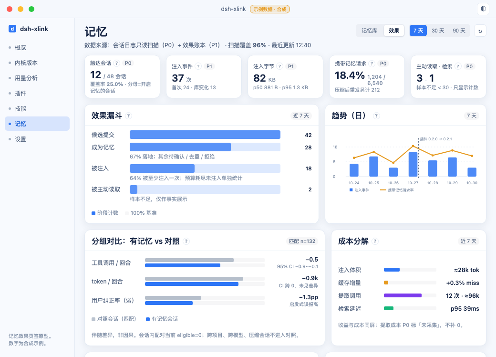
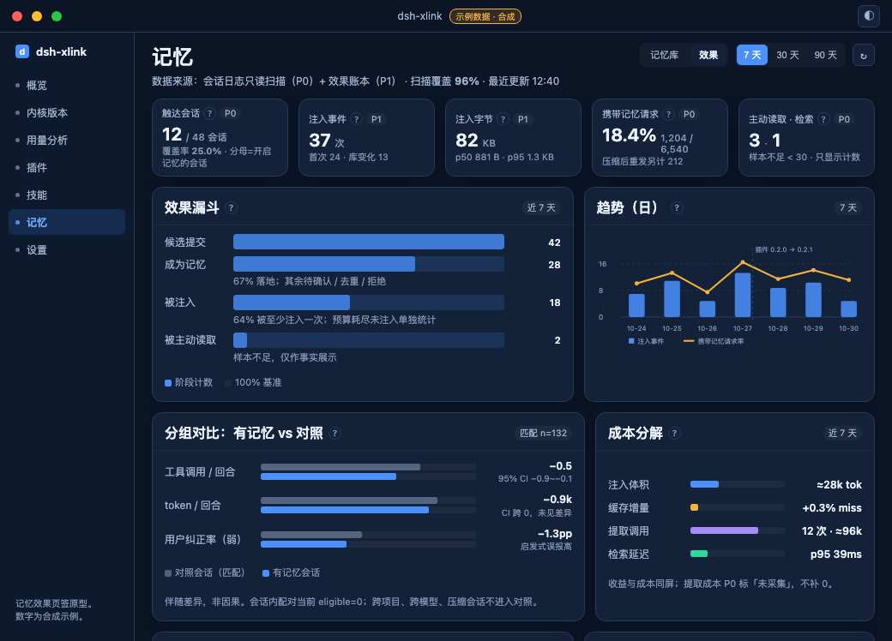

# 记忆效果可视化设计：把「记忆有没有用」变成可复核的读数

> 状态：**P0 已实现（2026-10-31）**——本机记忆页新增「效果」页签：只读扫描会话日志与 `memory.json` / `jobs.json`，展示读数条、效果漏斗、趋势、榜单、成本与数据健康（后端 `src-tauri/src/memory/effect/` 的 `memory_effect_report` 命令，前端 `ui/src/memory/MemoryEffectPanel.vue` + `ui/src/memory/effect.js`，判据 `cargo test --locked memory::effect` 与 `npm run test:ui`）。**P1/P2 仍未做**：持久化注入账本、分组对比与置信区间、未注入原因分解、会话下钻、实验开关。本文保留设计动机、度量模型与数据采集方案，其余阶段与进度见 memory-progress.md。
>
> 依据：dsh-xlink-memory-design.md、memory-progress.md、cache-impact.md、adr-20261023-handoff-experience.md、powercontext-extraction-plan.md，以及 plugins/memory/**、src-tauri/src/memory/**、src-tauri/src/usage/**、ui/src/memory/** 的当前代码。

## 0. 摘要

- 记忆模块的**控制面**已经相当硬（有界注入、用户主权、项目隔离、单写者、可审计），但它的**观测面**停留在「刚才发生了什么」：一条进程内、上限 20 条的注入环形 + 每条记录两个计数。它无法回答「用了记忆之后，内核的回合有没有变短、工具调用有没有变少、成本有没有变化、用户有没有少纠正」。
- 根因不是缺一个图表，而是四个断链：**计数语义断链**（被注入 ≠ 被采用）、**持久化断链**（历史不可回算）、**结果断链**（注入事件与回合结果没有 join）、**对照断链**（没有对照组，无法区分「记忆有用」与「任务本身变简单」）。
- 本方案分三层递进，且**只允许按证据强度说话**：L1 事实层（可直接下结论的计数/分布/成本）→ L2 关联层（注入 vs 未注入的分组对比，只能写「伴随」）→ L3 因果层（需要受控实验，默认不做，作为可选能力设计）。
- 数据上做两件事即可闭环：① 把 `/v1/memory/note` 的注入回报从「进程内环形」升级为**持久化效果账本**（加 session/turn/step/reason/bytes/plugin_version 等字段，90 天保留、只存 id 与字节、不存正文）；② 复用用量统计已经验证过的**会话日志增量扫描器**，把「带记忆的请求 / 预算（usage）/ 工具调用 / 回合结果」解析成按会话×回合的聚合账。两者按 session + 请求 seq 对齐；turn/step 在压缩后会重置，不能当全局键。
- 面板落点：记忆页新增「效果」页签（推荐）。首屏是 5 个事实读数 + 漏斗 + 趋势；第二屏是分组对比、成本、数据健康；第三屏是榜单与归因声明（整页可滚）。每个读数同时给出分母、样本量、覆盖率与口径 tooltip；**首版不给单一「有效性总分」**，避免用一个无法证伪的数字替用户下结论。
- 原型见 [effectiveness-dashboard-mockup.html](effectiveness-dashboard-mockup.html)（合成示例数据）。

---

## 1. 问题与现状

### 1.1 用户要回答的三个问题

1. **有没有用**：开启记忆之后，智能体是否更少重复问、更少走弯路、更快完成任务？
2. **值不值**：为记忆付出的 token、缓存、提取调用与延迟，是否小于它省下的成本？
3. **哪里失效**：是没命中、没注入、模型没看、看了没用，还是记忆本身陈旧/错误？

这三个问题需要三种不同强度的证据，不能用一个「记忆命中率」概括。

### 1.2 记忆模块一条链路（度量视角）

| 阶段 | 谁在做 | 关键约束 | 留下的信号 |
| --- | --- | --- | --- |
| 写入 | 用户保存 / 模型提候选 / 自动提取落地 | 单写者、schema 6、删除留指纹 | memory.json：created_at/updated_at/verification/state |
| 检索 | 壳 query.rs | 关键词+标题匹配、固定项优先、确定性排序 | 命中 id 列表（仅内存） |
| 渲染 | 壳 render_context | 最多 6 条、单条 8 KiB、单次 12 KiB；带 `[id] 标题（范围·验证，更新于…）` 表头 | 注入文本（进模型上下文） |
| 注入 | 插件 pre-step + 运行上下文贡献 | 每会话 8+2 次、累计 36 KiB、内容没变不算 | /v1/memory/note 回报（session/workspace/ids/enabled） |
| 使用 | 模型 | 正文已在上下文；可选 memory_search / memory_read / memory_propose | 会话日志中的工具调用；memory_read 计 use_count |
| 提取 | 插件 run.js → 壳 jobs | 失败不回退远端；内容闸门；自动落地（无冲突时） | jobs.json 任务状态；候选/记忆记录 |
| 结果 | 内核 | 回合/请求/压缩/工具调用 | 会话 JSONL：user/message 快照（`source.sections[]` 含 `xlink.memory` 段）、assistant/message usage、tool 事件、turn/end、compaction/prune（`shadowedSeqs`） |

### 1.3 为什么今天回答不了（四个断链）

**断链 A：计数语义。** 面板上的「被注入 N 次」统计的是 `recall_count`（store.rs 的 MemoryRecord 字段，由 note 路由 +1），它只能证明「这条内容被放进了模型上下文」；「模型读过 N 次」统计的是 `memory_read` 被调用并读完全文的次数。短记忆正文已经随注入给全，模型没有理由再读一遍，所以 `use_count = 0` 是常态而不是失败。README 目前把 recall_count 说成「前者才说明它被模型用过」，这是把「可见」当成了「采用」——用户因此产生过「模型读过 0 次，记忆是不是没生效」的误判（2026-10-31 c7c0a2cf 的修法是把 recall_count 落地，但它只解决可见性，不解决采用证明）。

**断链 B：持久化。** 注入实况只存在于 `memory/recent.rs` 的**进程内环形**（上限 20 条、重启即空、只存标题与 id）；面板只展示最近 5 条；`recall_count` 是累计标量，没有时间序列，历史注入也无法从磁盘回算（2026-10-31 的提交明确写了「历史次数不回填」）。因此趋势图、时间窗对比、按项目/按插件版本的比较都没有数据基础。

**断链 C：结果。** 注入事件（note）与内核的回合结果（usage、工具调用、耗时、结束原因）没有 join。壳里唯一读会话日志的是 `usage/local.rs`，它只按「天 × 模型」预聚合 token，主动丢弃了 session/request 粒度；而 memory 模块不读会话日志。于是「这条记忆注入后那一回合花了多少 token / 调了几次工具」在系统里根本不存在。

**断链 D：对照。** 记忆开关是实例级二元开关且改开关要重启工作台；没有会话级随机化，没有影子/对照组。仅凭「开记忆的会话」与「没开记忆的会话」直接对比，会把任务类型、会话长度、压缩次数、用户行为全部混进来——cache-impact.md 已经示范过这种混淆（含记忆的会话命中率 89.7% vs 98.3%，但差异来自两个会话各自上百次压缩，不是记忆）。

### 1.4 范围与非目标

- 本文只设计**观测**，不改变注入主链路的检索/渲染/预算行为（除非为了采集字段而扩展 note 契约，且保持向后兼容）。
- 不追求「一个数字证明记忆有用」；不把 L2 关联写成 L3 因果；不在面板上编造不可得数据（进度、星标、编造百分比这类在现有面板决定里已明确禁止）。
- 不采集/不落盘记忆正文；账本只存 id、字节、计数、时间与状态。会话日志的正文只在本地扫描时读取，产出聚合数字。

---

## 2. 功能设计评审（可观测性视角）

### 2.1 设计取舍与它对度量的含义

| 取舍 | 为什么这样做 | 度量上的代价 |
| --- | --- | --- |
| 运行上下文注入，不改 system prompt / AGENTS.md | 不冒充最高优先级指令，且缓存友好 | 注入块随对话增长被压缩影响；「是否注入」要从快照里识别 |
| 每会话 8+2 次、36 KiB 硬预算 | 防长会话快照膨胀 | 未注入 ≠ 不相关：预算耗尽、开关关、探测去重都会让分母失真 |
| 内容没变不算一次注入 | 防每回合换正文 | 「注入事件数」不是「相关次数」 |
| 项目隔离 + 通用偏好 | A 项目资料不进 B 项目 | 效果不能跨项目简单平均，必须按 workspace 分组 |
| 模型只读 + 提候选，自动提取直接落库 | 用户主权 vs 可用性折中 | 自动落地（未验证）的记忆没有「用后是否被纠正」的闭环 |
| 单文档 JSON + 原子替换 + 文件锁 | 免 SQLite、单写者事务 | 没有事件流/时序，追加统计要另立账本 |
| 默认关闭、两个开关、改开关需重启 | 隐私与安全优先 | 自然实验窗口少且不干净；开关状态要进账本才能归因 |

### 2.2 强项（值得保留的观测基础）

1. **硬边界**：条数/字节/次数三道闸全部落在策略层，且「只数内容真变」的语义写进了 policy.js，这使成本上界可计算（12 KiB × (8+2) = 120 KiB 最坏）。
2. **缓存代价已被实测且有结论**：cache-impact.md 用 6 周 25,981 次请求 / 56.3 亿 token 证明「记忆块只追加在对话尾部、不进 system prompt；控制压缩后，有记忆 96.73% vs 无记忆 96.83%」。成本侧不是黑盒，可以直接进面板当护栏指标。
3. **注入回报由插件发、不由桥自记**：插件只在「内容真的变了、已进入上下文」时回调 `/v1/memory/note`，探测路径被丢弃，口径比桥侧观察干净得多；扩展字段的成本远低于另起采集链。
4. **会话日志扫描范式已经跑通**：usage/local.rs 的多帧 zstd 增量扫描、variant 代际去重、90 天保留与状态文件，是现成的工程模板；scripts/analyze-prompt-cache.mjs 是现成的只读解析范式。
5. **generation 语义对测量友好**：`meta.generation` 只在内容写入时 +1、注入计数不抬代次——埋点不会改变被测的缓存失效行为；效果账本可以用 (namespace, generation, 时间) 对齐「库当时是什么样」。
6. **确定性排序支持回放**：固定项 → 分数 → 验证等级 → last_used_at → updated_at → id，同一输入永远同一顺序；这是离线复现与对照实验的前提（代价是 last_used_at 会随时间漂移，回放要带上它）。
7. **失败语义分层**：关闭/未命中/检索失败/预算用尽在代码里有各自的分支与日志，给了「未注入原因分解」的骨架，只是还没有聚合与落盘。
8. **隐私边界先于统计需求**：recent.rs 只存标题与 id；note 参数不含正文；日志只记路由与计数；jobs 错误不含模型输入。效果账本必须原样延续这条纪律。
9. **用户主权与删除纪律**：模型不能改库；删除留指纹防再生；项目范围先查后判。这些约束让「效果读数」不会建立在越权数据上。
10. **文档与判据纪律**：设计稿/进度表分离、判据带反向验证。新面板的每个数字都能指出数据来源与已知缺陷。

### 2.3 缺口清单（G1–G15）

> 每条给：现象 → 证据 → 对「证明有效性」的影响 → 建议。严重度按对目标的影响排序。

**G1｜计数单位错位：「被注入 N 次」是快照次数**（严重度高）
- 现象：面板行内「被注入 N 次」读起来像「用过 N 次」。
- 证据：插件只在注入正文变化或首次注入时回报（plugins/memory/host/index.js:668-687）；壳逐 id +1（src-tauri/src/memory/routes.rs:128-137 → store.rs:1198-1217）。内核把快照留在历史里到压缩为止（cache-impact.md:16-20），所以「注入 1 次」在该会话后续每个请求里都可见。它既不是会话数、也不是请求数、更不是采用次数。
- 影响：跨条目比较、趋势与「效果」都会被这个单位误导。另：**成功压缩会清零预算并重新注入**（policy.js:566、index.js:136），所以单会话真实注入可以超过 8 次——本机实测单会话最多 45 次注入快照；预算语义是「每个压缩周期 8+2 次」，不是「每会话 8 次」。
- 建议：主读数改用「触达会话数」；「被注入次数」保留但 tooltip 写清单位是「快照次数」。

**G2｜use_count = 0 是结构性常态，不是无效证据**（严重度高）
- 证据：只有 `memory_read`（按 id 读全文）增加 use_count（store.rs:1166-1178）；`memory_search` / `memory_context` 不计数；正文已随注入块给全（单条 8 KiB）。
- 影响：把 0 当「记忆没用」会系统性唱衰。
- 建议：面板把 use_count 折叠/显示「—」，新增主动检索与引用等旁证；文案明确「看到 ≠ 采用」。

**G3｜注入历史易失**（严重度高）
- 证据：recent.rs 环形进程内、上限 20、只标题与 id、重启即空（recent.rs:24-41）；面板只列 5 条（MemoryPanel.vue:405）；recall_count 历史不回填（memory-progress.md:216-229）。
- 影响：任何趋势/时间窗/对照都做不了。
- 建议：会话日志扫描先补事实层（T0），再把注入账本落盘（T1）。

**G4｜注入与回合结果断链**（严重度高）
- 证据：memory 模块不读会话日志；usage/local.rs 只聚合天×模型、丢弃 session/request 粒度；jobs.json 与 shell_events 都不含「哪次请求看到了哪条记忆」。
- 影响：只能数「注入了多少次」，不能回答「注入之后省了多少」。
- 建议：会话扫描器输出 session×turn 聚合，与账本 join（P1）。

**G5｜「未注入」是多因一果**（严重度高）
- 证据：至少 10 种原因——开关关（query.rs:454-459）、插件未接线、无关键词且非 pinned（query.rs:198-243）、条数上限 6、单条 8 KiB / 总量 12 KiB 裁剪、会话预算 8+2 次 / 36 KiB（policy.js:186-209）、预算用尽后换目录、桥 1.5 s 超时、查询截 500 字符、工作区/子智能体范围不匹配、文档损坏。
- 影响：拿「未注入」当「不相关」会把预算/开关/失败全算成记忆无效。
- 建议：账本记录 reason（injected / disabled / no_hit / budget / bridge_failed / probe_no_change），面板做「未注入原因分解」。

**G6｜模型主动通道的采用不可见**（严重度中高）
- 证据：三个工具里只有 memory_read 计 use_count；memory_search / memory_context 的调用没有进入任何面板字段（index.js:735-750、807-837 走 /context，routes.rs:50-103 只写日志）；query.rs 注释提到「memory_search 在 10537 次工具调用里只被主动用过 1 次」，原始数据不在仓库（未复核）。
- 影响：无法判断模型会不会自己查记忆、工具提示词是否有效。
- 建议：从会话日志工具事件统计三个工具的调用/结果；检索类调用单独一层「主动检索」。

**G7｜自动提取是记忆库主要来源，但没有质量闭环**（严重度中高）
- 证据：无冲突/取代标记的提取结果直接落成未验证记忆（store.rs:1031-1058、design.md:168）；本机 7 条记忆 6 条 source=extract；13 条候选 6 accepted / 7 rejected。
- 影响：「记忆条数↑」只说明提取链在跑；无法判断提取质量。
- 建议：把后续状态（被注入/读取、被编辑/停用/删除）作为提取产出的质量标签，按 extractor 版本聚合。

**G8｜提取链健康度与成本不可见**（严重度中高）
- 证据：本机 jobs.json 80 条：done 24 / failed 36（45%）/ pending 20；失败以「模型没有返回任何内容」36 条与「拿不到会话 live 对象」20 条为主；pending 恰为 QUEUE_CAP=20（jobs.rs:26）；已收尾任务从不修剪（jobs.rs:290-351）；任务不记 token/耗时/产出条数；done 只表示提交成功，可能 0 条候选。
- 影响：「提取没产出」与「记忆无效」会被混为一谈；提取成本回答不了。
- 建议：任务表加计数与成本字段（T1），面板单列「提取健康」；已收尾任务定期修剪。

**G9｜验证/陈旧只有标签，没有过程**（严重度中）
- 证据：verified/unverified/stale 由用户编辑或候选来源变化产生（design.md:164、store.rs:72-76、1141-1145）；没有最近验证时间、stale 持续时长。
- 影响：算不了陈旧率趋势，也回答不了「验证过的记忆是否更常带来好结果」。
- 建议：verification 作为分组维度；用注入后行为/后续沿用交叉，不把标签当质量结论。

**G10｜隔离与开关分层让归因复杂**（严重度中）
- 证据：项目按 scope_matches 隔离；存储按实例×profile（paths.rs:421-436）；开关三层（meta.use_approved 每请求读取 / 插件接线需重启 / 「处理中」只说明插件来没来问）——recent.rs:44-88、memory.js:252-274。
- 影响：总平均掩盖项目差异；开关前后窗天然混杂。
- 建议：默认按项目分组；开关/版本变更点标在时间轴上，不直接当 A/B。

**G11｜隐私约束限制可展示内容**（严重度中）
- 证据：recent.rs 只存标题与 id；note 不含正文；日志只记路由与计数。
- 影响：「记忆正文参与了多少次回答」这类证据不能落盘。
- 建议：账本只存 id/字节/计数；标题按需从库解析；会话文本证据只以聚合数字出现。

**G12｜成本分析停留在离线文档**（严重度中）
- 证据：cache-impact.md 与 scripts/analyze-prompt-cache.mjs 是一次性分析，不进入面板。
- 影响：用户看不到成本，也无法判断预算调整（3→8）是否值得。
- 建议：缓存/字节/token/提取成本做成护栏读数（P1），并在预算或提取器变更时自动对比前后窗口。

**G13｜快照重发造成双计风险**（严重度中）
- 证据：cache-impact.md §3.2：91 份含记忆正文的快照里 61 份是压缩后原样重发。
- 影响：直接数「含记忆的请求」会把压缩后的重复暴露当成新注入。
- 建议：明确两个口径——注入事件（账本权威）与携带有记忆的请求（会话扫描）；面板分别命名。

**G14｜经验/交接零真实样本**（严重度低）
- 证据：本机 handoffs=0、experiences=0；相关预算与召回逻辑没有真实数据可验。
- 影响：相关指标只能标「未验证」，不能给 0%/0 次。
- 建议：面板为这三类内容显式空态；指标先占位不发布。

**G15｜「最近注入」是可见性卡片不是效果读数**（严重度低但影响定位）
- 证据：MemoryPanel.vue 只列 5 条；tooltip 自述它是实况。
- 影响：用户想判断效果时会盯着这张卡，但它不回答效果。
- 建议：效果页签独立；「最近注入」保留在记忆库页签并链到效果页。

### 2.4 现有可观测信号盘点

| 信号 | 数据源（file:line） | 口径 | 持久性 | 能回答 | 已知缺陷 |
| --- | --- | --- | --- | --- | --- |
| recall_count | store.rs:239,1198-1217；写入 routes.rs:128-137 | 记录出现在「被采用的新注入块」中的快照次数，仅 enabled=1 | 落盘，不回填 | 触达总量（粗）、零触达条目 | 单位是快照；无时间/会话/回合；同会话刷新重复计数 |
| use_count / last_used_at | store.rs:233-236,1166-1178 | 模型主动 memory_read 次数/最后时间 | 落盘 | 显式读取强度 | 只覆盖读全文；search/context 不计数；正文已给全时结构性为 0 |
| 「最近注入」环形 | recent.rs:33-41,90-95；cmd.rs:135-139 | 插件真实注入的会话/项目/开关/标题列表 | 进程内、20 条、重启即空 | 刚才发生了什么 | 无 turn/step/字节/代次；只标题；面板 5 条；不参与聚合 |
| memory-bridge 日志 | routes.rs:44-48；shell_events | 路由 + enabled + hits 计数（+错误前缀） | 按日轮转 | 插件是否在调用壳、调用量级、失败 | 无 id、无会话、无字节；只能 grep |
| 提取任务表 | jobs.rs:64-74,467-484；cmd.rs:31-59 | 每任务状态/尝试/错误/键 | jobs.json 落盘，不修剪 | 提取链健康度、失败阶段、积压 | 无 token/耗时/产出数；done≠有产出；pending 饱和 |
| meta | store.rs:290-307 | schema/generation/use_approved/auto_extract/suppressed | 落盘 | 库版本、写入代次、开关、删除抑制数 | auto_extract 是死字段；suppressed 无时间戳 |
| 候选裁决 | store.rs:68-70,1022-1058 | pending/accepted/rejected + decided_at + 来源 + 标记 | 落盘 | 人工裁决量、候选处理速度 | 不能当质量；无「模型建议 vs 实际采用」差异 |
| 面板检索预览 | cmd.rs:141-160 → query.rs:446-489 | 模拟：给定查询会注入什么 | 即时 | 调试检索 | 不是实况 |
| 会话日志（未接入） | cache-impact.md:168-181；先例 usage/local.rs:1-34 | user/message 的 `source.kind==runtime-context` + `sections[].name==xlink.memory`（结构化，不靠文本 marker）+ assistant usage + compaction/prune | 内核侧原始日志 | 请求级 token、注入请求 vs 未注入、工具调用、曝光区间 | 壳内无记忆读取方；只有 v4 有 sections（本机 v0=159/v2=7/v3=57/v4=188）；正文不可外泄 |
| 内置插件状态 | plugins/builtin/mod.rs:75-90 | wired/load_state/requested_enabled | 落盘 | 记忆功能有没有在跑 | 不反映运行时是否真的加载成功 |

### 2.5 本机样本现状（2026-10-31 只读实测）

> 只报聚合。结论先说：**当前问题不是「没有数据」，而是「小样本 + 断链」**；效果面板必须把「数据不足」当一等状态。表里 recall 合计在一个小时内从 7 涨到 25——不是统计错误，是当前这台机器上的会话还在持续注入；这正好说明累计计数在没有时间窗与分母时不能当趋势用（G1/G3）。

| 指标 | 值 |
| --- | --- |
| 记忆条数 / accepted / disabled | 7 / 7 / 0 |
| 范围 / 来源 / 验证 | project 6、general 1；user-manual 1、extract 6；verified 7 |
| recall_count 分布 / 合计 | 19:51 采集 [4,2,1,0,0,0,0] / 7；20:2x 复采 [3,3,0,3,7,4,5] / 25（同一小时内因会话继续注入而增长） |
| use_count 分布 / 合计 | [1,0,0,0,0,0,0] / 1 |
| 候选 / accepted / rejected | 13 / 6 / 7 |
| 交接 / 经验 | 0 / 0 |
| 提取任务 / done / failed / pending | 80 / 24 / 36 / 20 |
| 任务提取器版本 | /4 53、/5 27 |
| 任务最新更新时间 | 2026-10-28 21:57 |
| meta | schema 6、generation 34、use_approved true、auto_extract false |
| dev 实例记忆库 | 空库（schema 5） |
| 会话日志格式分布（全量 411 文件） | v0 159 / v2 7 / v3 57 / v4 188；注入痕迹**只在 v4**（本机 2026-10-16 起） |
| memory-bridge 日志（近 16 天） | `/context` 688 次、`read` 1 次（≈0.15%）；enabled 614 次中 hits≥1 482（78.5%）、hits=0 132（21.5%） |

### 2.6 评审结论

记忆模块目前的形态是「**可控、可审计、不可证明**」：控制面（预算、权限、隔离、用户主权）做得比大多数插件都硬，但观测面只够支撑「刚才发生了一次注入」。补齐方式不是加一堆图表，而是先补一层**事实账本**（注入事件 + 会话结果），再谈关联与归因；否则任何「有效性」读数都会变成不可复现的观感。P0 必须能零行为改动地先跑起来（会话日志只读聚合）；注入账本与 join 放 P1；采用代理与实验放 P2。


---

## 3. 度量模型：把「正向作用」拆成可计算的指标

### 3.1 定义与证据分级

**正向作用 = 收益 − 成本**，但收益与成本不是同一类东西：成本可以精确记账（token、字节、请求数、延迟），收益只能通过行为代理间接观察。因此本方案把结论分成三级，面板必须逐条标注，禁止越级：

| 级别 | 能说什么 | 需要的证据 | 面板表达 |
| --- | --- | --- | --- |
| L1 事实 | 「发生了 N 次」「占比 x%」「成本 y token」 | 计数/分布/账本与扫描器 | 直接读数 + 样本量 + 分母 |
| L2 关联 | 「注入的回合比未注入的回合平均少 x 次工具调用（伴随，不自证因果）」 | 同一会话/同项目/同模型的配对或匹配队列 | 差异 + 置信区间 + 混杂提示 |
| L3 因果 | 「开启记忆使 … 下降 x」 | 随机化或可辩护的准实验 + 预注册口径 | 只在实验页出现，带实验编号与窗口 |

不追求单一「有效性总分」。原因：把「节省的 token」与「少一次纠正」加权成一个分数，权重是拍脑袋的；一个看起来精确的总分会诱导用户接受一个无法证伪的结论。面板给的是**一组可核对的读数 + 一个需要人工判断的结论区**。

### 3.2 指标树

#### A. 供给层（记忆库本身有没有东西、新不新）

| ID | 指标 | 口径/公式 | 数据来源 | 方向 | 陷阱 |
| --- | --- | --- | --- | --- | --- |
| S1 | 库存 | accepted 状态的记忆/经验/交接条数（按 scope 分） | memory.json | 中性 | 多 ≠ 好 |
| S2 | 项目覆盖 | 至少 1 条项目记忆的活跃项目数 / 近 30 天活跃项目数 | memory.json + 会话扫描 | 高好 | 通用偏好不算项目覆盖 |
| S3 | 陈旧率 | verification=stale 或 updated_at 超过 90 天的条数 / 总条数 | memory.json | 低好 | stale 是用户/模型标的，不是事实过期 |
| S4 | 提取产出率 | 自动提取落地条数 / 已完成提取任务数；并给每 100 回合产出 | memory.json + jobs.json + 会话扫描 | 中性偏高 | 高产可能意味着低质 |
| S5 | 候选裁决率 | accepted / (accepted + rejected)（区分自动落地与人工批准） | memory.json | 高好 | 自动落地不经用户裁决，要单列 |
| S6 | 质量回流率 | 自动提取落地后 30 天内被用户编辑/停用/删除的比例 | memory.json（updated_at/state/来源） | 低好 | 删除可能是隐私原因，不全是质量问题 |

#### B. 触达层（记忆有没有真的进上下文）

> 口径提醒：`recall_count` 的单位是「快照次数」（同一会话刷新多次会 +N；压缩后重新注入还会继续加），不是会话数也不是请求数。面板主读数用「触达会话数」；「被注入次数」保留但必须写明单位。
>
> **曝光（exposure）的定义**：请求 r 对记忆 m 曝光 ⇔ 存在一次注入快照 s（包含 m 的 id），满足 `s.seq < r.seq`，且 s 没有被 r 之前的任何 compaction/prune 的 `shadowedSeqs` 遮蔽。单位是「条·请求」；它是比 recall_count 更接近「模型看到过」的口径，也是成本归因的分母。


| ID | 指标 | 口径/公式 | 数据来源 | 方向 | 陷阱 |
| --- | --- | --- | --- | --- | --- |
| R1 | 注入覆盖会话率 | 有 ≥1 次真实注入的会话 / 开关开启且插件在线的会话 | 效果账本 + 会话扫描 | 高好 | 分母要排除开关关、插件未接线 |
| R2 | 注入事件数 | 账本 applied 次数，按 first / library-change 分 | 效果账本 | 中性 | 不是「相关次数」；去重后内容没变不算 |
| R3 | 单次注入体量 | 每次注入的条目数、字节数 p50/p95/max | 效果账本 | 中性 | 字节大不一定有用 |
| R4 | 零命中率 | 检索成功但 0 条命中的回合 / 检索回合 | 账本 | 低好 | 与「开关关」「检索失败」分开 |
| R5 | 预算耗尽率 | 达到 8 次或 36 KiB 的会话 / 有注入的会话 | 账本 + policy 常量 | 低好 | 耗尽后的回合「未注入」不代表不相关 |
| R6 | 携带记忆请求率 | 存在有效记忆快照（未被 prune 遮蔽）的请求 / 全部请求；按「至少一条记忆曝光」计（会话扫描口径） | 会话扫描 | 高好 | 压缩后重发的快照仍会进入后续请求（设计如此），要与「新注入事件」分列 |
| R7 | 检索延迟 | 壳侧检索 p50/p95（已有实测 32.5/39 ms，满库 1000 条） | 壳 perf 日志 / 账本 | 低好 | 冷缓存未单独量过 |
| R8 | 未注入原因分解 | 各 reason（disabled/no_hit/budget/bridge_failed/probe_no_change）计数 / 检索回合 | 账本（P1，按 reason 变化上报） | 中性 | 首版没有账本时只能给「未注入」总数，不给原因 |

#### C. 采用层（模型有没有看/用；这一层最容易把「看到」当「用」）

| ID | 指标 | 口径/公式 | 数据来源 | 方向 | 陷阱 |
| --- | --- | --- | --- | --- | --- |
| U1 | 主动读取 | memory_read 调用次数 / 会话数 / 千次工具调用 | 会话扫描（tool/call）；T0 也可用 memory-bridge 日志估量级 | 高好 | 正文已随注入给全时天然为 0；本机近 16 天 `/context` 688 次而 `read` 仅 1 次 |
| U2 | 主动检索 | memory_search 调用次数 / 结果条数 / 后续是否触发注入 | 会话扫描 | 高好 | 搜了没用也算一次调用 |
| U3 | 候选提交 | memory_propose 调用次数 / 成功候选数 | 会话扫描 + 面板账 | 中性 | 提得多可能提示词过度积极 |
| U4 | 注入→读取转化 | 被注入条目中后续被 memory_read 读完的比例 | 账本 + 会话扫描 | 高好 | 稀有事件；样本不足不给百分比 |
| U5 | 条目粘性 | 某条记忆在 30 天内被注入/读取的天数 | 账本（需持久化） | 中性偏高 | 高频可能只是标题宽泛 |
| U6 | 回复引用（弱） | 助手回复文本中出现注入记忆标题的回合 / 注入回合 | 会话扫描（本地文本，只计数） | 高好 | 注入块本身含标题，需排除用户消息与快照；只能当弱信号 |

#### D. 产出层（内核效率与质量的代理；L2 才允许说「伴随」）

| ID | 指标 | 口径/公式 | 数据来源 | 方向 | 陷阱 |
| --- | --- | --- | --- | --- | --- |
| O1 | 每请求 token 结构 | input / cacheRead / cacheWrite / output 的均值与 p50 | 会话扫描 assistant usage | 中性 | 必须按模型分组；不同模型不可比 |
| O2 | 工具调用强度 | 每回合工具调用次数、错误/重试次数 | 会话扫描 | 低好 | 任务难度未控制前不可跨组比较 |
| O3 | 回合长度 | 每会话回合数、每回合步数、会话时长 | 会话扫描 | 低好 | 长会话 ≠ 低效 |
| O4 | 用户纠正率（弱） | 下一轮人类消息含否定/改口启发式（不对/不是/改成/应该是/别…）的回合比例 | 会话扫描（只计数） | 低好 | 启发式误报高，只做趋势不做结论 |
| O5 | 重复交代率（弱） | 人类消息与 N 天前记忆/会话中已出现的约束相似的比例 | 会话扫描 + 记忆库（本地比较） | 低好 | 语义相似度不可靠，首版可做关键词重叠 |
| O6 | 异常结束率 | turn/end 的 reason.kind 非正常（error/cancel/abort）比例 | 会话扫描 | 低好 | 与记忆无直接关系，只做护栏 |
| O7 | 压缩强度 | 每会话压缩次数、压缩间隔 | 会话扫描 | 低好 | 强混杂项，必须进分层 |

#### E. 成本层（可精确记账；必须与收益同屏）

| ID | 指标 | 口径/公式 | 数据来源 | 方向 | 陷阱 |
| --- | --- | --- | --- | --- | --- |
| C1 | 注入体积成本 | 每次注入字节 × token/字节标定；或对照请求 usage 差 | 账本 + 会话扫描 | 低好 | 标定必须用同一模型/同一语言样本 |
| C2 | 缓存增量成本 | 记忆块变化后的下一次请求 cache miss 增量（对照无变化请求） | 会话扫描 + cache-impact 方法 | 低好 | 需控制压缩与 TTL；现有离线结论是 0.3% miss 量级 |
| C3 | 提取成本 | 提取任务数 × 每次调用的 token（需新增采集：提取调用不进用户会话日志） | jobs.json + 新增账本 | 低好 | 当前完全不可见 |
| C4 | 检索延迟 | 同 R7 | 同上 | 低好 | 与用户体验直接相关 |
| C5 | 历史快照膨胀 | Σ 注入字节（上限 36 KiB/会话） | 账本 | 低好 | 预算内 |

#### F. 护栏层（不出事比证明有效更重要）

| ID | 指标 | 口径 | 来源 | 阈值/动作 |
| --- | --- | --- | --- | --- |
| H1 | 越权拒绝 | 桥 read/note 因项目不匹配被拒次数 | 壳日志 | >0 时提示排查 |
| H2 | 开关关闭零注入 | 开关 off 时账本 applied 必须为 0 | 账本 | 判据 |
| H3 | 数据健康 | 会话解析覆盖率、失败率、未知事件占比、孤儿 id 率 | 扫描器自检 | 覆盖率 < 80% 暂停出比率 |
| H4 | 隐私红线 | 账本/状态文件不含正文（门禁扫描） | 判据 | 红即拒绝发布 |
| H5 | 预算上界 | 每会话注入字节 ≤ 36 KiB、事件 ≤ 10 | 账本 | 超限即 bug |
| H6 | 提取健康 | 提取失败率、积压任务数、连续失败 | jobs.json | 连续失败给原因 |

### 3.3 归因设计

四个设计从便宜到贵，面板按数据可用性逐级点亮；**没有 L3 实验就不展示 L3 结论**。

| # | 设计 | 分组定义 | 控制什么 | 能得出 | 不能得出 | 成本 |
| --- | --- | --- | --- | --- | --- | --- |
| 1 | 自然开关窗（DiD） | 开关前的项目/任务 vs 开关后同类，加一个未开记忆的项目作对照 | 时间趋势、项目固定差异、模型 | L2 关联（可提升到准因果） | 用户行为变化无法完全控制 | 低（只要账本） |
| 2 | 会话内配对 | 同一会话内，「首次注入前窗」vs「注入后窗」；只有在注入发生在会话中段时才成立 | 会话/模型/项目/工具集合、压缩 | L2 关联 | **注入是粘性前缀：快照追加后其后每个请求都可见，典型会话的首次注入发生在首个请求之前，本机当前 eligible=0**；预算耗尽与「无相关记忆」混在一起 | 低 |
| 3 | 匹配队列 | 同项目、同模型、任务类型/长度相近的「有注入会话」vs「无注入会话」 | 上述 + 长度与压缩分层 | L2 关联 | 选择偏差（检索命中本身与任务内容相关） | 中（需要匹配逻辑） |
| 4 | 随机影子实验 | 用户显式开启后，按会话随机 10% 跳过注入 | 一切可观测混杂 | L3 因果（同一总体随机化） | 样本量与时长要求高；用户可能感知缺失 | 高（改插件+开关+实验页） |

统计纪律（写进实现，不靠文案自觉）：

- **分析单元是会话，不是请求**：请求高度聚类于会话，报告时以会话为主；需要请求级差异时用会话内配对或聚类稳健标准误，不能把 1 万个请求当 1 万个独立样本。
- 样本量直觉：两组均值比较约 n≈15.7·(CV/相对效应)²/组（CV=0.5、要检测 20% 差异约 98/组）；配对差约 n≈7.85·(CV_d/rel)²（CV_d=0.3、检测 10% 约 71 对）。达不到就写「样本不足」。

- 比率在分母 < 30 时只显示计数与「样本不足」，不显示百分比。
- 分组差异同时给 95% 置信区间（比例用 Wilson，均值用 bootstrap 或 t 区间），区间跨 0 就标「未见差异」。
- 跨组比较必须同模型、同项目、同时间窗；压缩会话单列或排除（cache-impact.md 已经证明压缩能吞掉全部差异）。
- 任何 L2 文案统一用「伴随/相关性」，不得写成「导致/带来」；L3 只有实验编号存在时才允许。
- 实验预注册：开始前把指标、窗口、样本量写进账本文档，避免事后挑指标。

### 3.4 容易骗人的度量（面板必须避免）

| 骗法 | 为什么骗人 | 面板处理 |
| --- | --- | --- |
| 把「被注入次数」当「被使用次数」 | 注入只证明内容进了上下文 | 命名与 tooltip 明确「模型看到 ≠ 采用」 |
| 把「注入次数」当「相关性」 | 内容没变不重复注入，预算也会用完 | 同时给「检索回合」「零命中率」「预算耗尽率」 |
| 只给「有记忆会话」的命中率对比 | 压缩、任务难度、会话长度、冷启动全混在一起 | 必须分层（压缩/无压缩、模型、项目、冷启动），并给样本量与配对方式 |
| 把「首次注入所在请求」当注入成本 | 首次注入与冷启动高度重合（实测 input 中位 51.9k vs 全体 0.995 缓存占比） | 只用会话内配对或匹配队列，并标出冷启动/压缩剔除规则 |
| 用文本 marker 扫「记忆注入」 | 本机全量扫描里“以下是本机保存的/xlink.memory”在 134 条 tool/result、126 条 assistant/message、77 条 tool/call 里出现（讨论/回显），会大量误判 | 必须解析 JSON 的 `source.kind` + `sections[].name`；marker 仅作兜底 |
| 小样本百分比 | 3 次注入 100% 有效 | n<30 只显示计数 |
| 用总量而不是率 | 注入多只说明用得多 | 每个率都给分母 |
| 把成本藏在别处 | 只报收益不报 token/缓存/提取 | 收益与成本同屏 |
| 单一有效性总分 | 权重不可辩护，结果不可复核 | 首版不做；最多给分组读数 |
| 用「模型读过 0 次」下结论 | 短记忆正文已给全，不需要再读 | 文案解释，并加主动检索/引用等旁证 |

### 3.5 最小可行读数（分两档，先零行为改动）

**P0（T0：只读聚合，不改插件/不改写入行为）** 只承诺回答「有没有在用、成本多少、数据可不可信」：

1. 记忆库存结构（条数/范围/来源/验证/年龄）与零触达条目占比（注明 recall 从 2026-10-31 起才有）。
2. 会话扫描：携带记忆的请求数 / 请求总数、注入快照数、注入段落字节 p50/p95、压缩后重发数。
3. 提取链健康：done/failed/pending、失败按 stage 聚合、队列是否触顶。
4. 数据健康：扫描覆盖率、解析失败、未知事件、版本混合。

**P1（T1：注入账本 + join + L2）** 追加：

5. 注入事件（权威账本）与触达会话数、未注入原因分解、预算触顶率。
6. 同会话配对与匹配队列的 L2 差异（带置信区间与样本量）。
7. 注入 vs 未注入的 token/缓存/工具调用对照（控制压缩与 TTL）。

L3 因果实验作为 P2 的可选能力，默认不启用。


---

## 4. 数据方案：从哪里拿到这些数

### 4.1 总原则

1. **双源**：壳侧效果账本负责「注入事件」的权威计数（插件回报，语义干净）；会话扫描器负责「携带有记忆的请求 / usage / 工具调用 / 回合结果」的客观事实（内核日志，独立可复核）。两者用 session + turn 对齐，任何对不齐的样本显式标为「未关联」。
2. **只读 + 只聚合**：扫描器只读会话文件；账本只写 id、字节、计数、状态；正文不出内存、不进账本、不进日志。
3. **跟实例走**：所有新文件落在 `<instance_dir>/memory/<profile>/effect/`，与 memory.json 同源隔离（dev/release 分开、按实例分开），路径统一经 `shell::paths`，不写死。
4. **向后兼容**：note 契约只加可选参数；旧插件照常工作（新字段取缺省值并标记「旧版」）。账本 schema 带版本号，未知字段忽略。
5. **可重算**：账本损坏或版本升级时，能从会话日志重算的部分重算；不能重算的（真实注入事件）保留原始记录文件，聚合结果只是缓存。
6. **先零改动**：P0 只用「memory.json + jobs.json + 会话日志」做只读聚合，不改插件、不改 note 契约；注入账本（P1）只加可选字段，旧插件缺省即降级。

### 4.2 注入效果账本（P1）

**写入点**：桥的 `/v1/memory/note` 路由（`src-tauri/src/memory/routes.rs::note`）。插件在「内容真的变了」时回报，语义已经是「这一次真的进了上下文」。

**契约扩展**（全部可选，旧插件缺省）：

| 字段 | 类型 | 含义 | 缺失时 |
| --- | --- | --- | --- |
| at | RFC3339 | 事件时间（壳侧生成） | 必填 |
| session | string | 内核会话 id | 原样保留（展示/关联用，不参与授权） |
| turn / step | integer | 事件发生时所在回合/步（插件从 pre-step 上下文取；取不到传 -1）。**压缩后会重置，不能当全局键** | -1 = 未关联 |
| epoch / event_seq / request_seq | integer | 压缩周期；插件侧事件序号；消费该注入的请求 seq | 缺失时只能按时间近似 |
| kind | enum | memory / experience / handoff | memory |
| reason | enum | turn（回合预算内首次）/ library-change（库变化刷新）/ probe（预算外探测且真的变了） | unknown |
| enabled | bool | 当时开关状态 | 必填 |
| ids | string[] | 本次真正进上下文的条目 id（记忆/经验/交接） | 必填 |
| entries | [{id, bytes, truncated}] | 每条渲染后的字节数 | 缺失按 0 |
| total_bytes | integer | 本次注入块字节数 | 缺失按 0 |
| generation | integer | 注入时的数据代次 | 缺失按 0 |
| plugin_version / kernel_version | string | 归因用（版本间对比） | 缺失标 unknown |

**存储**：

- 事件明细：`memory/<profile>/effect/notes-YYYY-MM.jsonl`（追加写、0600、按月分文件；每行一个事件）。
- 聚合缓存：`memory/<profile>/effect/state.json`（增量扫描结果 + 最近一次报告缓存，原子替换）。
- 保留：明细 90 天（与用量统计一致），超期按月删除；聚合缓存同样只保留 90 天窗口。
- 体积上界：注入事件 ≤ 10 次/会话，按每天 50 个会话估算 ≤ 500 行/天，90 天 ≤ 4.5 万行、约几 MB；达到 10 万行时触发压缩（只保留聚合所需字段）。

**未注入原因分解**：note 只在「内容真的变了」时上报，拿不到 disabled/no_hit/budget 这些 0。P1 让插件在**状态桶变化时**额外上报一次 skip 事件（同一会话同一原因只报一次，避免每回合一次 HTTP），原因桶：`disabled` / `no_hit` / `budget` / `bridge_failed` / `probe_no_change`。这组事件只用于原因分解，不计入注入次数。

**幂等键**：`namespace + session + turn + step + generation + ids`；同键只记一次，防插件重试或双壳重复。

**隐私**：不写标题、不写正文、不写模型输出；`workspace` 只存工作区 id（UUID）；路径只在展示时从工作区注册表现查（与面板现有做法一致）。

### 4.3 会话效果扫描器（P0 先跑扫描 / P1 再 join）

**复用**：`src-tauri/src/usage/local.rs` 的工程骨架——按文件 offset 增量、多帧 zstd、变体代际去重（只认最高版本）、90 天窗口、状态原子替换、扫描 TTL。新增模块建议 `src-tauri/src/memory/effect/scan.rs` + `effect/mod.rs`（拆分理由：扫描与聚合是两件事，且 memory 目录已有 16 个模块，不再往 store.rs 里塞）。

**路径**：`paths::instance_dsh_home(family, id).join("sessions")`（与 usage 同源）；实例由 `instance::resolve_default()` 决定（生产调用方不许硬编码默认实例 id）。

**解析目标**（以 telemetry 实测为准，下面按已核实的内核事件形状设计）：

| 事件 | 用途 | 关键字段 |
| --- | --- | --- |
| `user/message` + `data.source.kind == "runtime-context"` + `data.source.form == "snapshot"` | 识别一次注入快照 + 注入 id / 字节 | **结构化**取 `data.source.sections[]` 中 `name == "xlink.memory"` 的段：段文本长度即记忆段字节，`[32位hex]` 表头正则提取 id。该事件**没有 turn/step**，只有 seq；turn/step 由消费它的请求（下一条 assistant/message）回填 |
| `assistant/message` | 请求计量与模型、turn/step 的权威来源 | `data.usage`（inputTokens/outputTokens/cacheReadTokens/cacheWriteTokens）、`data.message.source`（provider/model）、`data.turn` / `data.step` |
| `compaction/prune` | 曝光区间与混杂控制 | `data.shadowedSeqs` / `data.shadowedRange` / `data.shadowedTokenCount`；被遮蔽的快照不再对后续请求可见 |
| 工具调用事件 | 三个记忆工具的采用 | 工具名（memory_search/read/propose/context）、参数、结果、turn |
| `turn/end` | 回合结果 | `reason.kind`（正常/取消/错误）、耗时 |
| `compaction/end` | 混杂控制 | 压缩是否成功、发生在哪个回合前 |

**聚合输出**（每条请求一行，落 state）：

`{session, turn, step, at, model, memory_bearing, memory_ids, memory_bytes, input, output, cache_read, cache_write, tool_calls, tool_errors, memory_tool_calls, end_reason, compaction_before}`

**关联策略**：

1. 账本有 `event_seq`（插件侧事件序号，与内核事件 seq 可对齐时）：直接 join `(session, event_seq)`。
2. 账本无 seq：按 `(session, 时间窗 ±5s)` 关联到最近的 memory-bearing 请求，标 `linked_by = "time"`。
3. 曝光区间由扫描器独立计算：快照 seq → 被哪个 prune 遮蔽 → 得到它对哪些请求可见。账本只提供「注入事件」，曝光由日志事实决定。
4. 关联不上：计入「未关联注入」，在数据健康卡显示比例；**未关联不进入 L2 对比的分子分母**。

**去重与口径**（关键）：

- **注入事件**：以账本为准（插件 applied 次数）。
- **携带有记忆的请求**：以会话扫描为准（快照含记忆块的请求，含压缩后原样重发）。
- 两个口径在面板上分列，禁止相加或互相替代。

### 4.4 聚合与命令（P0 只读聚合 / P1 加账本）

新增 Tauri 命令（放 `memory/cmd.rs`，登记 `lib.rs`）：

| 命令 | 返回 | 用途 |
| --- | --- | --- |
| `memory_effect_report(range_days, force)` | 时间窗元信息、覆盖率、事实计数、日序列、漏斗、成本、健康度、Top 记忆 id 列表 | 效果页签主数据 |
| `memory_effect_session(session_id)` | 注入事件 + 逐回合 usage/工具调用（无正文） | 会话下钻 |
| `memory_effect_notes(limit)` | 最近注入明细（id、字节、reason、关联状态） | 替换/补充现有 recent 环形 |

**口径在 Rust 侧计算，前端只渲染**：所有率、分组、置信区间由后端算，避免前端各写一套（本仓已有教训：三处标签各写一份，靠判据钉住）。前端只做格式化与展示。

**性能**：首次全量扫描按 usage 实测（47 文件/679MB 解压 2.5s；内核会话 409MB）预计 1–3s；之后按增量毫秒级；报告读取带 90s TTL（与 usage 的 FRESH_SCAN_INTERVAL_MS 同量级），「刷新」强制重扫。首版只扫窗口内 mtime 的文件，冷启动不阻塞面板（后台任务 + 骨架屏）。

### 4.5 数据质量与降级

| 检查 | 判据 | 不满足时 |
| --- | --- | --- |
| 扫描覆盖率 | 成功解析的会话 / 窗口内会话 ≥ 95% | 显示覆盖率，比率标「估算」 |
| 未知事件占比 | 未知 type / 总事件 < 5% | 健康卡警告，提示内核版本可能不兼容 |
| 关联率 | 账本注入事件能按 session + 请求 seq 关联到扫描请求的比例 ≥ 90%（无 seq 时允许时间兜底并单列） | L2 对比降级为「样本不足」 |
| 孤儿 id | 账本 id 不在 memory.json 的比例 < 1% | 警告（可能是删除后旧账） |
| 版本混合 | 同一时间窗内内核/插件版本数 | 版本切换点标在趋势图上 |
| 损坏文件 | 扫描失败文件数 | 跳过并列出，不静默清零 |

### 4.6 隔离、安全与性能预算

- 新增文件全部经 `paths::instance_memory_effect_*` 解析，落在实例目录内；dev/release 天然隔离（实例不同）。
- 文件 0600、原子替换；JSONL 追加写用 `O_APPEND`（单写者）；损坏时重建并告警，绝不覆盖用户记忆库。
- 不新增网络请求；不读外部目录；不碰 `~/.codex` 等第三方数据。
- 单次扫描 CPU 预算：首扫 ≤ 3s、增量 ≤ 100ms（与 usage 对齐）；内存峰值 ≤ 50MB（流式解码，不整文件读入）。
- 新代码体积：预计 Rust +600~900 行、UI +500~700 行；遵循现有文件预算与拆分规则，超线先拆模块而不是抬预算。

### 4.7 可行性实证（2026-10-31 只读探针）

**探针**：近 30 天、default + default-dev 两个实例、按 mtime 过滤、同一会话多代 variant 取最新一份；多帧 zstd 解码；只读聚合、不输出正文/标题/路径。结果：

| 项 | 值 |
| --- | --- |
| 样本 | 63 个会话文件（default 57 / default-dev 6） |
| 体积与耗时 | 压缩 95.64 MB → 解压 321.19 MB；5.5 s |
| 解析健康 | 解码失败 0、JSON 解析失败 0、未知事件 0；窗口内全部 v4 格式（全量历史：v0 159 / v2 7 / v3 57 / v4 188，注入痕迹只在 v4） |
| 注入 | default：12 个会话有注入、86 次注入快照；default-dev：0（空库） |
| join 可行性 | 86/86 次注入可通过 `sections` 定位；turn/step 由消费请求回填；84 次由同一 step 的请求消费、1 次跨 step、0 次未消费 |
| 注入体量 | 单次字节 p50 881 / p95 1297 / max 1486，30 天合计 81,715 B；每次 1–3 个 id；去重后仅 4 个不同记忆 id 被注入 |
| 用量 | 12,850 条带 usage 的 step / 12,862 次请求（default 12,712 + dev 138）；usage 字段有 3 种形状 |

**探针顺带实测到的两个坑**（它们直接决定了方案里的口径）：

1. **快照数 ≠ 注入次数**：每会话注入快照 p50 2、p95 45、max 45，有 2 个会话超过 8 次——原因有两个：压缩后同一份快照会被内核原样重发（cache-impact.md §3.2 量到 91 份中 61 份是重发），以及成功压缩会清零预算并重新注入（policy.js:566）。这正是 G13：面板必须把「注入事件（账本）」与「携带有记忆的请求（扫描）」分开，并按压缩周期（epoch）解释 >8 次。
2. **裸分组会立刻骗人**：未控制的分组里，「首次注入所在 step」的 input 中位数 51,918、缓存命中比例中位数 0.176，而全体 step 是 0.995——因为首次注入与**会话冷启动**高度重合。拿这组数直接说「记忆让缓存变差」是错的；必须做会话内配对或匹配队列并控制冷启动、压缩与 TTL。这条实测比任何文案都更能说明为什么面板要分 L1/L2/L3。

- **不要用文本 marker 扫描**：全量日志里“以下是本机保存的 / xlink.memory”会出现在 tool/result（134 条）、assistant/message（126 条）、tool/call（77 条）里，必须解析结构化 `sections`。

**结论**：P0 的数据可行性成立（零插件改动即可覆盖近 30 天 63 个会话、12,862 次请求、86 次注入快照）；但「注入次数」与「成本」的裸对比必须按上面的口径加工后才能展示。更早的 cache-impact.md 已用同一套日志完成 25,981 次请求 / 56.3 亿 token 的请求级分析，进一步证明解析路径可复用。


---

## 5. 可视化方案

### 5.1 落点：记忆页新增「效果」页签

| 方案 | 做法 | 优点 | 缺点 | 结论 |
| --- | --- | --- | --- | --- |
| A 记忆页双页签 | `记忆库` / `效果`，默认记忆库 | 语义同源（都是记忆）、入口不增、共享项目/时间上下文、可复用现有面板原语 | 页面复杂度 +1，需要懒加载 | **推荐** |
| B 记忆页底部嵌卡 | 现有页面下方加一张效果卡 | 改动最小、一眼可见 | 窗口 1040×748 固定，记忆列表与「最近注入/提取任务」已占满；效果需要独立时间窗与下钻 | 不推荐 |
| C 独立侧栏入口 / 用量分析页 | 新增「记忆效果」入口，或挂在用量分析里 | 独立、可扩展 | 入口膨胀；用量页口径是 token 成本，不是插件效果；与记忆页的「最近注入」割裂 | 备用（将来做「插件有效性」总框架时可升级） |

页签内不设二级导航；所有切换用顶部时间窗（7/30/90 天）与项目筛选完成。

### 5.2 信息架构与布局（1040×748，侧栏 157px，内容区约 851px）

```
┌ 记忆效果 ─────────────────────────────────────────────── [7天|30天|90天] [刷新] ┐
│ 数据说明：账本 + 会话扫描 · 覆盖 96% · 最近更新 12:40                          │
├──────────────┬──────────────┬──────────────┬──────────────┤
│ 触达会话      │ 注入事件      │ 注入字节      │ 携带记忆请求  │ 主动读取/检索 │
│ 12 / 48 会话  │ 37 次         │ 82 KB         │ 18.4% (1,204) │ 3 / 1 次      │
│ 覆盖率 25%    │ 每次 2.1 条    │ p50 881 B     │ 压缩后重发另计 │ 样本不足      │
├──────────────┴──────────────┴───────┬──────────────────────┤
│ 效果漏斗                              │ 趋势（日）            │
│ 候选 → 落地 → 注入 → 主动读取          │ 注入事件/携带请求柱线  │
├──────────────────────────────────────┼──────────────────────┤
│ 分组对比：注入 vs 未注入（同会话配对）│ 成本分解              │
│ 工具调用/回合、token/回合（带 CI）     │ 注入token/缓存/提取   │
├──────────────────────────────────────┼──────────────────────┤
│ 记忆榜单（Top 注入 / 零使用 / 陈旧）  │ 数据健康 + 归因声明    │
│ 未注入原因分解（开关/未命中/预算/失败）│                      │
└──────────────────────────────────────┴──────────────────────┘
```

- 顶部读数条：5 个事实读数（触达会话 / 注入事件 / 注入字节 / 携带记忆请求 / 主动读取·检索），每个都带分母、样本量与 P0/P1 来源角标；分母不足 30 时小字写「样本不足」而不是百分比。
- 主口径：触达用「会话数」而不是「注入次数」；`recall_count` 只能当快照次数，不能当使用次数。
- 时间轴：起点必须标出数据起点（recall_count 自 2026-10-31 才有；会话扫描可回溯到有记忆注入的更早会话），之前的区间画灰缺口，不默认画成 0。
- 内容区约 843px（1040 − 157 侧栏 − 40 内边距）；卡片间距 12px；效果页允许整页滚动（滚动只发生在主区，侧栏不动）——首屏 KPI + 漏斗 + 趋势，第二屏分组对比/成本/健康，第三屏榜单。与记忆库页「整页钉在窗口内」不同，这是内容密度决定的，落地时在 panel-decisions 记一条。
- 所有卡片标题旁的 ⓘ 必须说明口径与已知缺陷（与现有面板「最近注入」的做法一致）。

### 5.3 卡片规格

| # | 卡片 | 回答的问题 | 图表 | 主要字段 | 空态/错误态 |
| --- | --- | --- | --- | --- | --- |
| 1 | 读数条 | 现在有没有在用、用的规模多大 | 5 个数字块 + 小字分母 + P0/P1 来源角标 | 触达会话/分母、注入事件数、注入字节、携带记忆请求率、主动读取/检索次数 | 「还没有数据：开启记忆并聊几轮后出现」 |
| 2 | 效果漏斗 | 记忆在哪一步流失 | 水平漏斗（候选→落地→注入→主动读取） | 各阶段计数与阶段转化率 | 缺口阶段灰色；数据不足标「样本不足」 |
| 3 | 趋势 | 这段时间在变好还是变差 | 柱（注入事件）+ 线（携带记忆请求率） | 日序列、版本切换标记、压缩占比条 | 少于 3 天数据不出趋势，只给总数 |
| 4 | 分组对比 | 注入的回合和没注入的回合差在哪 | 成对柱状（配对差值 + 95% CI） | 工具调用/回合、token/回合、用户纠正率（弱） | 样本不足时只显示计数；领先给「伴随差异」声明 |
| 5 | 成本分解 | 为记忆付了多少 | 堆叠条/小环 | 注入 tokens、缓存 miss 增量、提取调用、检索延迟 | 提取成本未采集时标「未采集」，不补 0 |
| 6 | 记忆榜单 | 哪些记忆在干活、哪些在占位 | 列表（Top 注入/零使用/陈旧） | id→标题、注入次数、主动读取、最后注入时间、验证状态 | 空库显示「还没有记忆」；标题按需从库解析 |
| 7 | 数据健康 | 这些数能不能信 | 状态行 + 警告列表 | 扫描覆盖率、解析失败、未知事件、关联率、孤儿 id、版本混合 | 覆盖率 < 80% 时所有比率加「估算」角标 |
| 8 | 归因声明/实验 | 我能下什么结论 | 文案块 + 实验入口（P2） | 当前证据级别、样本量、混杂提示、实验开关 | 无实验时只写 L1/L2 边界 |
| 9 | 未注入原因分解 | 没注入是开关、没命中、预算还是失败 | 横向条/小表 | disabled / no_hit / budget / bridge_failed / probe_no_change 计数 | 首版无账本时只显示「未注入总数」并说明原因待采集 |

**下钻**：
- 点会话读数 → 会话时间线弹窗：每次注入（时间/turn/条目数/字节）、该回合 usage、工具调用、压缩标记；无正文。
- 点榜单条目 → 复用现有 MemoryDetail（已有详情弹窗与动作），不新造一层。
- 点数据健康 → 展开明细（哪些文件解析失败、哪些注入未关联）。

### 5.4 视觉、交互与可访问性

- 严格复用 `ui/src/theme.css` 的语义 token 与页面原语（`.page-head` / `.card` / `.page-list` / `.btn`），不新增颜色名；字号走仓库档位：页面标题 24px、块标题 16px、正文 12px、辅助信息 ≥10.5px（不得靠压字号解决密度，密度用分屏与滚动解决）。
- 图表**手写 SVG/CSS**，不引入图表库（现有用量页的环形图与柱条就是手写 SVG；引入库会撞 UI 产物体积预算）。
- 明暗双主题只认 `html.dark`；图表颜色从语义 token 取，不在 SVG 里写死 hex。
- 交互：时间窗切换、刷新（`force`）、下钻、项目筛选（默认本实例，项目是筛选器，不新增「当前项目」状态）；加载态用现有 `v-loading`；错误态显示命令错误与「重试」，不静默空。
- 空态分三种，文案不许混：没有数据（功能未接入）/ 数据不足（n 太小）/ 功能没在跑（开关或接线）。
- 可访问性：图标按钮带 `title` + `aria-label`（现有判据）；图表提供 `role="img"` + `aria-label` 文本摘要；颜色不是唯一编码（同时给数值/文字）。
- 数字格式：token 用 `formatTokens` 同款口径；百分比保留 1 位小数；时间用本地时区；「天」按本地日历日归属（与用量统计一致）。

### 5.5 原型

- [effectiveness-dashboard-mockup.html](effectiveness-dashboard-mockup.html)：自包含单文件（内联 CSS/JS、无外部请求），按 1040×748 面板比例、明暗双主题、合成示例数据（页面顶部明确标注「示例数据」）。
- 交互：时间窗切换、卡片下钻（示例）、主题切换。
- 原型只验证信息架构与视觉密度，不代表最终 Vue 实现；落地时按 `MemoryPanel.vue` + 独立组件拆分。
- 数字为合成示例（约 7 天 37 次注入 / 82 KB / 1,204 个携带请求），与本机真实样本（§2.5、§4.7：30 天 86 次注入 / 81.7 KB）不是同一份数据；不要把原型数字当证据。





### 5.6 关键文案（口径工具提示）

| 位置 | 文案 |
| --- | --- |
| 「被注入」 | 自动放进会话上下文、模型看到过它。看到不等于采用；内容没变不会重复注入。 |
| 「携带记忆的请求」 | 这一次模型请求的上下文里包含记忆块（压缩后原样重发的快照也会计入）。与「注入事件」是两个口径。 |
| 「主动读取/检索」 | 模型自己调用 memory_read / memory_search。正文随注入给全时通常不需要再读，0 次不是故障。 |
| 「分组对比」 | 同一会话内注入回合与相邻未注入回合的差异，只能说明伴随关系，不能证明因果。 |
| 「成本估算」 | 注入 token 由字节标定估算；缓存 miss 按相邻请求差分；提取成本单独采集。 |
| 「数据健康」 | 覆盖率不足或不兼容时，不显示比率，只显示计数。 |

---

## 6. 实施计划

### 6.1 阶段划分

| 阶段 | 目标 | 能回答的问题 | 预估 |
| --- | --- | --- | --- |
| P0 只读事实层 | 会话扫描器 + memory.json/jobs.json 聚合 + 效果页签骨架（读数条、漏斗、趋势、健康度） | 有没有在用、规模多大、成本多少、数据可不可信 | 1–1.5 天 |
| P1 注入账本 + 关联层 | note 契约扩展、账本落盘、session/seq join、分组对比、未注入原因分解 | 哪里流失、和不用记忆相比差在哪（伴随） | 2–3 天 |
| P2 采用代理 + 可选实验 | 工具调用/引用代理、提取质量标签、随机影子实验、版本对比 | 哪些记忆值得留、插件版本是否变好（因果） | 3–5 天 |

### 6.2 文件级改动清单（P0/P1）

| 层 | 文件 | 改动 |
| --- | --- | --- |
| 插件（P1） | `plugins/memory/host/index.js` | note 回报补 turn/step/reason/bytes/generation/版本；取不到就传缺省 |
| 插件（P1） | `plugins/memory/host/policy.js` | 把 applyStep 的 reason（turn/library-change）、渲染字节与 skip 原因桶暴露给回报调用 |
| 壳桥（P1） | `src-tauri/src/memory/routes.rs` | note 解析新参数（缺省兼容），写账本 + 保留 recent 环形 |
| 壳 | `src-tauri/src/memory/effect/mod.rs`（新） | 账本读写、保留策略、聚合数据结构 |
| 壳 | `src-tauri/src/memory/effect/scan.rs`（新） | 会话日志增量扫描、事件解析（纯函数 + IO 分离） |
| 壳 | `src-tauri/src/memory/effect/report.rs`（新） | 指标聚合、Wilson 区间、分组、健康度 |
| 壳 | `src-tauri/src/memory/cmd.rs` / `lib.rs` | 新增 3 条命令并登记 |
| 壳 | `src-tauri/src/shell/paths.rs` | 新增 effect 目录/文件路径函数（带 `validate_id_component`） |
| 面板 | `ui/src/memory/MemoryPanel.vue` | 顶部双页签 + 懒加载效果面板 |
| 面板 | `ui/src/memory/MemoryEffectPanel.vue`（新） | 8 张卡与下钻（拆子组件） |
| 面板 | `ui/src/memory/effect.js`（新） | 格式化与纯展示派生（比率只在后端算） |
| 面板 | `ui/src/memory/memory.css` | 效果页样式（复用 token，不新增全局类） |
| 测试 | `src-tauri/src/memory/effect/*` 内联单测 | 解析、账本、关联、聚合、保留、隐私 |
| 测试 | `ui/test/memoryEffect.test.js`（新） | 空态/样本不足/文案口径/模板结构 |
| 测试 | `e2e/specs/memory.spec.mjs` | 真壳能打开效果页、命令可解析 |
| 文档 | `docs/features/memory/memory-progress.md` | 实现时按维护规则补条目与判据 |
| 文档 | `docs/ui/panel-decisions.md` | 记录落点选择与卡片取舍 |

### 6.3 判据（每条都要能反向验证）

1. **解析**：固定夹具会话（多帧 zstd、v3/v4、含/不含记忆块、压缩重发）→ 断言识别出的注入 id、字节、turn/step；破坏 marker 或 id 正则必须变红。
2. **账本**：新增/缺省参数兼容、90 天裁剪、损坏重建、0600、无正文（扫描文件内容断言不含 body 字段）。
3. **关联**：按 session + 请求 seq 精确关联、无 seq 时时间兜底、关联失败计数；反向去掉兜底断言失败。
4. **聚合**：给定夹具的手算期望（计数/率/中位数/CI）逐项相等；样本不足规则（n<30 不出百分比）。
5. **口径隔离**：注入事件与携带记忆请求不得互相赋值；反向把两个口径接反必须变红。
6. **隔离**：dev/release 实例路径不同；临时 home 下不读真实家目录（沿用 `scoped_xlink_home`）。
7. **性能**：首扫 ≤ 3s、增量 ≤ 100ms、面板打开 ≤ 500ms（本机样本），超预算必须报错而不是静默慢。
8. **UI**：空态/错误态/加载态齐全；图标按钮 title+aria；无新依赖；明暗主题截图对比。
9. **隐私**：账本与聚合缓存正文关键词扫描为空；日志不落正文。

### 6.4 风险与对策

| 风险 | 表现 | 对策 |
| --- | --- | --- |
| 会话格式随内核版本变化 | 解析失败率升高、指标突然归零 | 变体代际去重 + 未知事件占比 + 覆盖率门槛；失败不归零，标「未覆盖」 |
| marker 文本脆性 | 识别不到记忆块 | marker 由壳自己渲染（可控）；同时用 id 表头正则兜底；版本化 marker |
| 双计 | 注入次数虚高 | 两个口径分列；压缩后重发单列 |
| 归因被误读 | 用户把关联当因果 | 三级证据标注 + 文案纪律 + 默认不展示 L3 |
| 性能 | 面板打开卡顿 | 增量 + TTL + 后台扫描 + 骨架屏 |
| 隐私 | 聚合数据泄露正文 | 只存 id/字节/计数；标题按需解析；门禁扫描 |
| UI 膨胀 | 面板复杂度失控 | 独立组件 + 现有原语 + 产物体积预算 |

### 6.5 明确不做

- 不做单一「记忆有效性总分」；不做跨项目平均；不把 L2 关联写成因果结论。
- 不采集记忆正文/模型输出进账本；不读取用户记忆以外的第三方目录。
- 不为了统计而修改注入预算、检索排序或渲染格式（note 契约只加可选字段）。
- 不在 P0 做实验框架；随机影子实验只在用户显式开启且能随时停止时做。

---

## 7. 验收

### 7.1 验收清单（用户视角）

- [ ] 打开记忆 → 效果页签，能在 1 屏内看到：是否在用（注入覆盖）、用了多少（事件/请求）、成本多少（token/缓存）、数据可不可信（覆盖率）。
- [ ] 每个数字都能通过 ⓘ 读到口径与分母；样本不足时不会被展示成百分比。
- [ ] 数据健康警告出现时，用户能照着它定位（哪些文件/哪些注入没关联）。
- [ ] 改开关/重启工作台后，页面能分辨「开关前/后」而不是把两个窗口混在一起。
- [ ] 任何「差异」都带「伴随/样本量」说明；没有实验就不出现因果措辞。

### 7.2 工程判据

- 新增 Rust 模块：`cargo test --locked memory::effect` 全绿；`cargo clippy --all-targets -- -D warnings` 零警告。
- 面板：`npm run test:ui` 中新增用例全绿；`npm run build:ui` + `check:ui-bundle` 通过。
- 全量门禁按发布规则在版本发布前跑；日常只跑命中项。
- 反向验证至少 5 条：解析 marker、口径接反、关联兜底、隐私扫描、隔离路径——每条确认破坏后真的变红。

### 7.3 边界

- 本设计不承诺「证明记忆有用」；它承诺把结论的证据等级、样本量与成本摊开，让用户/维护者能自己判断，并且不会因为一个漂亮数字被误导。
- 真实因果结论只有在完成 P2 随机实验后才允许出现；在那之前，面板里的对比一律是 L2。

---

## 8. 附录

### 8.1 术语

| 术语 | 定义 |
| --- | --- |
| 注入事件 | 插件把「内容发生了变化」的记忆块放进本次请求上下文并回报的一次事件（账本权威） |
| 携带记忆的请求 | 会话扫描发现该请求的 runtime-context 快照里包含记忆块（含压缩后原样重发） |
| 主动读取 | 模型调用 `memory_read` 按 id 读全文 |
| 主动检索 | 模型调用 `memory_search` / `memory_context` |
| L1/L2/L3 | 事实 / 关联 / 因果三级证据 |
| 关联率 | 账本注入事件能按 session + 请求 seq 匹配到扫描请求的比例（时间兜底单列） |

### 8.2 统计公式

- 比率置信区间（Wilson）：
  ```
  center = (p + z²/2n) / (1 + z²/n)
  half   = z·sqrt(p(1-p)/n + z²/4n²) / (1 + z²/n)
  ```
- 每轮成本差：同一会话内，注入回合与其相邻未注入回合的 token 差，取中位数（配对差），并给 bootstrap 95% 区间。
- 注入 token 估算：`bytes / 标定系数`；标定用同一模型、同一语言样本实测（对比带/不带记忆块的请求 usage 差），标定系数与样本量写进账本元信息。
- 缓存成本：只统计「注入块发生变化后的下一次请求」的 `cacheReadTokens` 变化，对比「无变化续写」的基线；压缩后的请求单独剔除（cache-impact.md 的方法）。
- 注入 token 标定：`T = ceil(bytes / k)`，k 点估 **3.07 B/token**（cache-impact.md：84 KiB ≈ 2.8 万 tokens），区间 k∈[2.8, 4.5]，必须标方法。
- 提取成本上界：`C_ext = Σ attempts × (T_slice + T_prompt + T_out) × P_miss`，`T_slice ≤ 24 KiB / k ≈ 8.6k`；本机 jobs.json 80 任务 attempts 合计 157 次 → 上界约 **1.35M input tokens**。jobs 目前不记 usage，P0 只能给上界，P1 补账。
- 曝光量：`Σ_m Σ_r [r 对 m 曝光]`（条·请求）；`recall_count` 不是它的替身。

### 8.3 本机可行性与现有样本

- 本机记忆库存/任务表聚合（2026-10-31）见 §2.5；结论是「小样本 + 断链」，任何百分比/趋势当前都没有统计意义。
- 会话日志侧：2026-10-31 只读探针（近 30 天 / 两实例 / 63 会话 / 12,862 次请求 / 86 次注入快照）已实测「注入快照识别 + turn/step 关联」：0 解码失败、0 JSON 失败、turn/step 可解析 86/86、84 次与同 step 请求对齐（详见 §4.7）。cache-impact.md 另完成过 25,981 次请求 / 56.3 亿 token 的请求级分析。
- 版本边界：全量 411 个日志文件 v0=159 / v2=7 / v3=57 / v4=188；v0–v3 没有 `sections` 字段，能解析但拿不到注入——**注入历史不能回溯到 2026-10-16 之前**（本机注入痕迹最早出现在 v4）。
- 边界：探针只读、只报聚合；`recall_count` 与 `use_count` 的历史不可回填，2026-10-31 前只能用会话日志重算「注入是否存在」，不能用计数器重算「触达」。历史注入总数存在 142 vs 86 的口径差异（全量 vs 窗口/variant），未核对。

### 8.4 评审边界与未验证事项

- 已核实：设计稿 §1–§12、进度表、cache-impact 实测、ADR、PowerContext 计划、插件 host 关键段、Rust memory 关键段、面板关键段、usage/local.rs 扫描架构。
- 未验证：① query.rs 注释引用「10537 次工具调用中 memory_search 仅 1 次」的原始数据不在仓库；② 注入账本/日志 join 的字段可解析率依赖内核版本，需要实现阶段实测；③ 跨壳双实例的账本隔离口径未实测；④ 本机 dev 实例为空库，无法验证多实例混算。
- UI 约束以 ui/AGENTS.md 为准：窗口固定 1040×748、侧栏 157px / 收起 64px（2026-10-25 起）。

### 8.5 与现有文档的关系

- 设计动机与机制：dsh-xlink-memory-design.md（本文不改它的结论，只补观测面）。
- 实现进度：memory-progress.md（本文 P0 实现后，按该文件维护规则补条目与判据）。
- 成本侧实证：cache-impact.md（本文复用其方法与结论作为成本基线）。
- 面板决定：docs/ui/panel-decisions.md（落点 A、卡片取舍、文案口径在实现时追加一条决定记录）。
- 插件有效性总框架：本文是「记忆」这个插件的实例；将来若做通用插件有效性面板，可复用「账本 + 会话扫描 + 三级证据」这套骨架。
