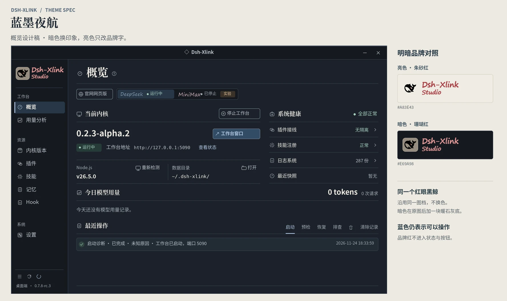

# Dsh-Xlink 暗色主题「蓝墨夜航」开发与验收稿

**状态：待实现。** 本稿定义桌面管理面板视觉和官网产品展示的同步要求，不宣告现行版本已有这些样式。关联：[Kami 七页设计合同](kami-implementation-2026-11/README.md) · [品牌资源规范](icon-design.md) · [窗口主题边界](../architecture/window-architecture.md#主题按窗口内容选择作用域)。

图为静态视觉稿，内容是示意数据，不新增、删除或重命名功能。旧布局、操作位置、真实数据和状态机以当前代码为准。

## 1. 范围与视觉优先级

- 暗色从绿黑／黄铜换成蓝墨灰／雾银蓝。保留现有布局、宋体标题、账页式分隔、信息密度和前景阅读顺序。用标题栏、侧栏、画布和浮层的底色分层，不加玻璃、发光或卡片套卡片。
- 亮色保持 Kami 现状，只把侧栏英文手写品牌字（`Dsh-Xlink / Studio`）的颜色调整为朱砂红；不改亮色控件、状态、画布、字重或排版。
- 明暗使用同一个原版红眼黑鲸 `ui/public/whale-icon.png`。暗色只给图标位置加暖石灰底；不反色、不改眼睛、不替换图源、不动托盘、系统图标或背景动效图集。动效与首帧／低动态模式保持原行为。
- 保留现有 `--font-hand` 和 Windows / macOS 字号差：只给侧栏英文品牌字及 DeepSeek / MiniMax 品牌词。中文标题仍用宋体；状态、按钮和说明沿用正文字体；日志和路径沿用等宽策略。
- 新调色覆盖主壳及壳自有日志、用量、套餐等副窗，不给 DeepSeek / MiniMax 工作台页面或第三方官网、登录／授权窗口覆盖 CSS。主题跟随与广播行为保持现状。

## 2. 色值与归属

| 角色 / 现有 token | 暗色值 | 应用 |
| --- | --- | --- |
| `--window` / `--chrome` | `#15191F` | 自绘标题栏、侧栏 |
| `--canvas` | `#1C222A` | 主内容；账页段可继续透明 |
| `--surface` / `--surface-raised` | `#222B34` / `#29323E` | 需要实底的状态行、浮层与弹窗 |
| `--surface-subtle` / `--surface-sunken` | `#222B34` / `#161B21` | 低层级区域 / 日志与代码 |
| `--border-soft` / `--border` / `--divider-strong` | `#2B3540` / `#343F4D` / `#4B5969` | 账页线，不用作需辨认的控件轮廓 |
| `--window-edge` | `#647284` | 悬浮窗与相邻窗口分界 |
| `--text` / `--text-secondary` / `--text-muted` | `#EEEAE3` / `#BDC4CD` / `#A2AAB5` | 主文本、次文本、空状态 |
| `--text-disabled` / `--control-border` | `#7C8795` / `#748495` | 禁用态、可操作控件边界；说明文字不要借用禁用色 |
| `--accent` / `--accent-strong` / `--focus-ring` | `#B2C8E5` / `#D0E0F3` / `#B2C8E5` | 有操作的链接、当前页、焦点。焦点用现有 2px 轮廓，轮廓与控件外缘错开 |
| 选中底 / 主按钮底 | `#273747` / `#334B64` | 选中用底色＋左侧线／下划线；主按钮底设独立语义值，勿直接把文字用的浅蓝铺作按钮底 |
| 主按钮悬停 / 按下 / `--on-accent` | `#3D576F` / `#293F55` / `#DDE9F7` | 常态文字可用 `#B2C8E5`，悬停、按下用 `--on-accent`；必要轮廓独立使用 `--control-border`，不能令轮廓色等于填色 |
| 成功 / 警告 / 错误文本 | `#A3CEBC` / `#E1C194` / `#F1A69F` | 只给状态，搭配文字或图形；对应浅色块 `#273B39` / `#393229` / `#3F2D31` |
| 内核名：DeepSeek / MiniMax | `#B2C8E5` / `#D4B6BD` | 只调可读文字 token，不改内核标志或官网主题色 |
| 新增 `--brand-wordmark` | `#E69A98` | 亮色定义 `#A83E43`；仅 `.brand__name` 读取，副行继承 |
| 新增 `--brand-mark-plate` / `--brand-mark-plate-edge` | `#968D80` / `#B0A79B` | 亮色均为 `transparent`；同一图槽背景，保留原图透明通道与气孔细节 |

交互强度：工作台已运行时，打开／切到工作台是首要动作，停止保持现有动作及保护逻辑；空闲时启动是首要动作。只有确认高风险操作或真实错误时使用对应警示色。若运行态停止按钮目前只写「工作台」，这次允许只调整该按钮的可见文案和对应无障碍名称为「停止工作台」；不改实际行为，也不改其他内核文案。

以实底 sRGB 估算：亮／暗字标对各自侧栏 **5.18:1 / 7.93:1**；黑鲸黑色对暗色标底 **6.42:1**；暗色正文对画布 **13.35:1**，弱文本对最亮浮层 **5.53:1**，主操作常态文字对按钮底 **5.27:1**，控件轮廓对最亮浮层 **3.38:1**。这是色值核算，不是实机结果。半透明叠色以真实背景合成后复算：可读文本至少 4.5:1，必要控件边界和焦点至少 3:1，装饰分隔线不视为控件边界。

## 3. 开发顺序

1. 在 `ui/src/theme.css` 中换 `html.dark` token，`:root` 只补品牌相关 token。同步深色 Element Plus 的主色派生档、语义状态、overlay、mask、输入边框、hover、focus、loading，以及热力图和日志等级的暗色派生；优先复用现有语义 token，不在各页散落十六进制。检查旧黄铜按钮专用覆写和淡绿浮层，不能保留第二套与新色竞争的配色。
2. 核对 `ui/src/shell/SideBar.vue` 与 `.brand__name`；字标用 `--brand-wordmark` 替代直接引用 `--whale-eye-bright`。后者留给原有鲸眼／活动指示，原 dev/release 窗顶细线也不改语义。标底在现有图标槽做成共用结构、由 token 开关；不更改图标尺寸、缩进、命中区，展开／折叠都不得挤占文字。共享几何放公用选择器，`html.dark` 只换颜色。
3. 逐页核对概览（两内核）、用量、内核版本、插件、技能、记忆、Hook、设置及壳自有副窗。菜单、Popover、Tooltip、选择项、确认弹窗、遮罩和加载层都要核对，不能只验主窗截图。不要改 `theme.js` 的持久化、广播或系统监听，也不要替换第三方页面的样式。
4. 更新既有主题契约，旧黄铜色值断言改为新语义，并保留「亮色不漂移」「切换不重排」和手写体作用域防线。保留原始视觉稿为历史，本稿仅替代暗色调色与品牌字颜色约定。

## 4. 官网产品页同步（同版交付要求）

官网目前是独立的浅色静态站：拖拽对比和功能图显示的是 `website/assets/` 中的截图，不会读取桌面端主题。只改 `ui/` 后，官网仍会展示旧绿黑与黄铜；不能用本设计稿代替发布截图。

1. **从同一版本重出七张图。** 视觉实现通过桌面验收后，用 [官网截图脚本](../../scripts/website-preview/README.md) 从同一个已验收的源码 commit 渲染真实 Vue 界面，使用同一套公开样例数据；按原文件名更新 `overview-{light,dark}.webp`、`plugins-{light,dark}.webp`、`memory-{light,dark}.webp` 和 `minimax-dark.webp`。亮图也重出，因为品牌手写字变了。保持 1040×748 CSS 像素、2× 导出（2080×1496），概览明暗画面同尺寸、同布局、同数据，以免拖动接缝跳位。不用私有数据或用户桌面截图；记录截图 commit、对应版本和运行环境到 [website/README.md](../../website/README.md)。
2. **统一品牌，不把整个站改成暗色。** `website/index.html` 与 `website/features.html` 顶栏继续用现有红眼黑鲸 `assets/whale-icon.svg`；共享 `website/style.css` 的顶栏英文主字标用亮色朱砂红 `#A83E43`。保留网站现有字族、导航、页面背景、说明字和响应式布局；产品截图内才使用应用的手写体与暗色调。操作色、CTA 和 favicon 不随品牌字重着色。已有截图标题和替代文本如果与内容不符，同步修正；预览大图、原图链接和普通链接回退必须指向同一套新图。
3. **网站验收。** `node --test website/site.test.mjs`。在 375、768、1440 px 确认首页明暗滑块（鼠标／触摸及键盘）不跳位；首页与功能页的插件、记忆切换，MiniMax 概览、放大、原图、Escape 和焦点恢复通过；两页字标一致，七张图均能加载。若部署仍看到旧图，再核对实际 URL 响应与缓存；需要缓存键时，把所有对应的 `src`、`href`、`data-light`、`data-dark` 一起更新并复测。
4. **发布顺序。** 官网截图、字标与桌面主题视为同一版本交付，但 `website/` 进入 `main` 会触发 GitHub Pages，并触发已配置的 Cloudflare Pages。网站更新先留在实现／配套分支，确认对应桌面安装包公开可下载后再合并或部署，并在两个站核对实图与下载指向。不能在设计 PR 合并时把概念图顶上官网，也不能提前把尚未上线的新主题当成当前可下载版本。

## 5. 桌面验收与回退

- **静态／前端**：在仓库根执行 `node --test ui/test/{darkThemeB,kamiTheme,designAlignment,epStyles,logWindowTheme,minimaxWordmark,themeContract}.test.js`（Bash / zsh，PowerShell 可用 `npm run test:ui`），再执行 `npm run build:ui`。断言两套同源鲸标、字标与鲸眼 token 解耦、亮色差异仅限品牌字、暗色无几何声明；正反验证至少一项对比度／颜色契约确实会发现回退。
- **Windows 首验**：在现有隔离开发配置中启动桌面端；100% / 125% 缩放、窄窗、侧栏折叠／展开，确认手写字不溢出、黑鲸轮廓与红眼可辨，品牌图槽不抖动。截图留同一数据、同一窗口尺寸、同一缩放的明暗对照。用 Tab 在选中项、主按钮和输入框之间移动，检查焦点、禁用和危险确认。
- **主题切换**：先同时开概览、日志、用量，再切亮→暗→跟随系统；包括系统切换和重开应用，核对壳自有副窗同步、弹窗不跳回旧调色。另开至少一个内核工作台，确认其外观仍按原偏好机制生效，不受壳颜色变量覆盖。
- **交付**：补 Windows WebView2 与受支持的 Intel macOS 实机截图，明确未验证的平台、窗口和缩放档位。浏览器预览不计入桌面验收。实现建议独立提交；需要回退时可撤回样式与契约提交，不涉及设置、数据迁移或主题枚举变更。
