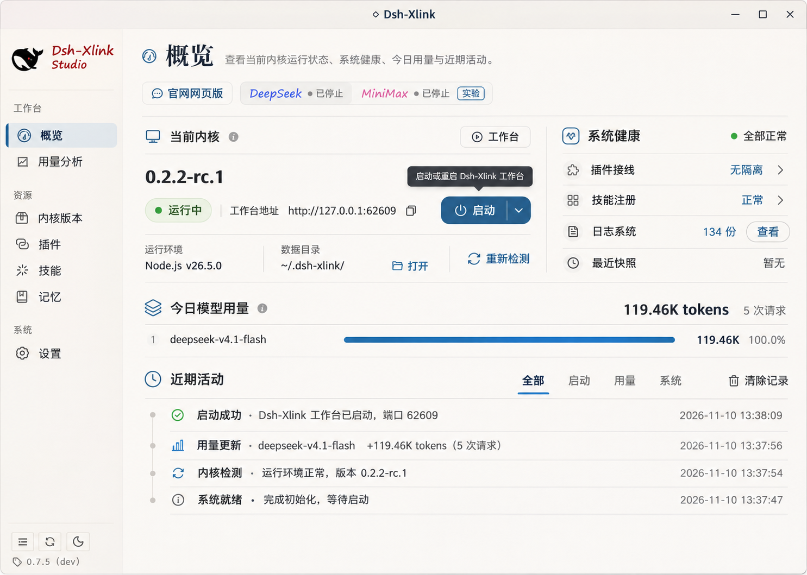
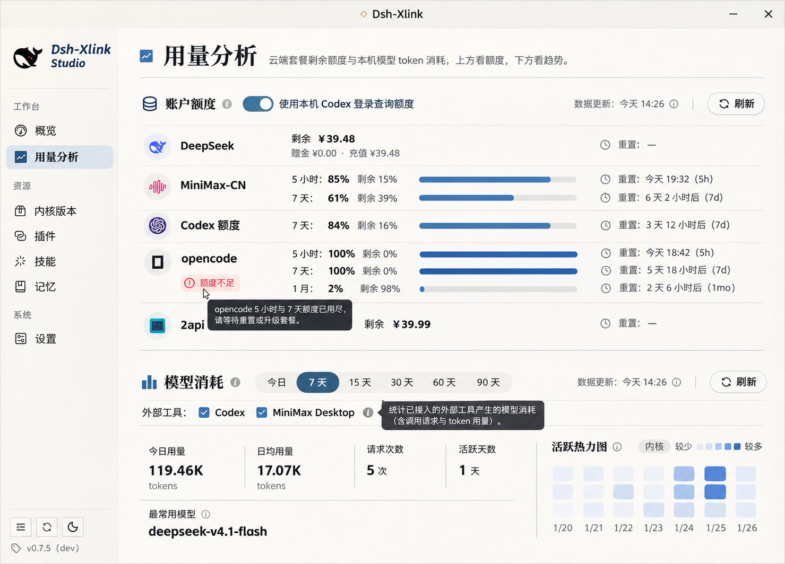
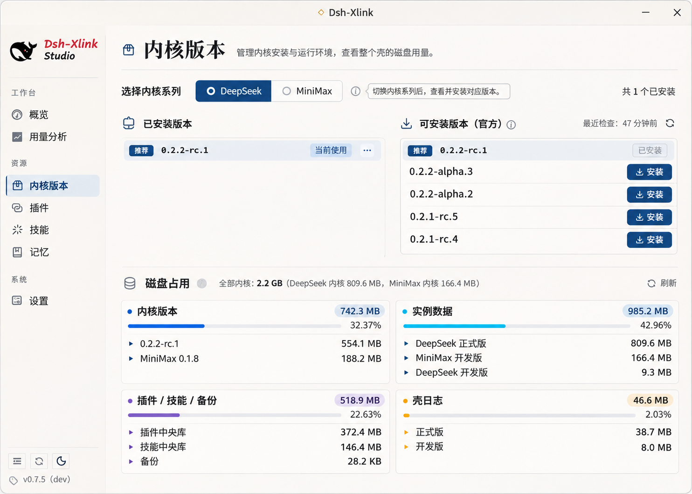
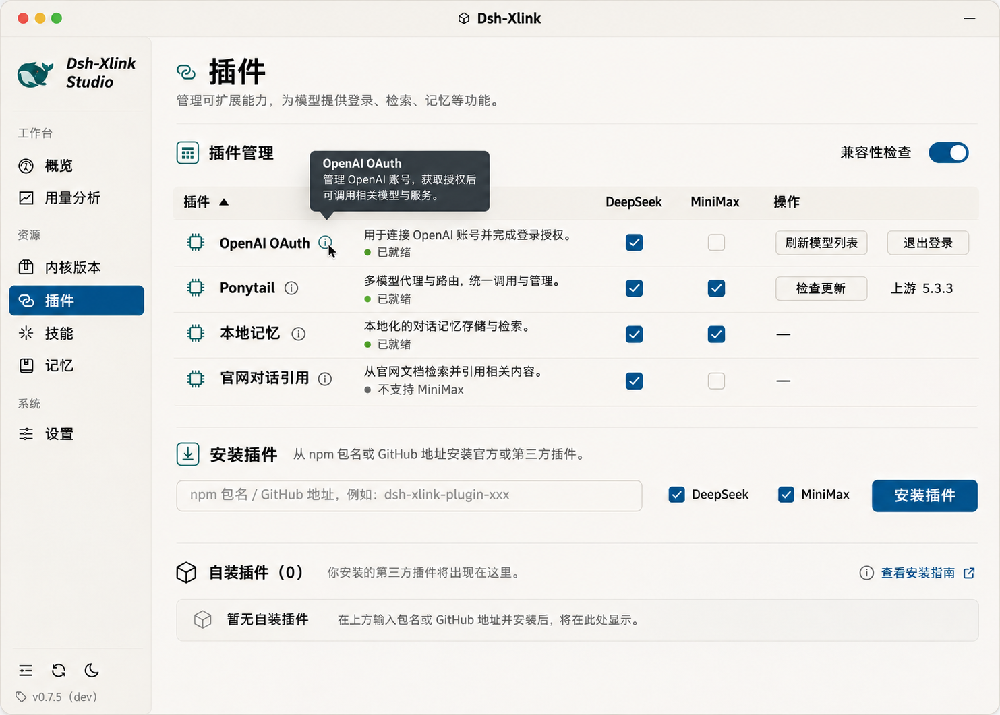
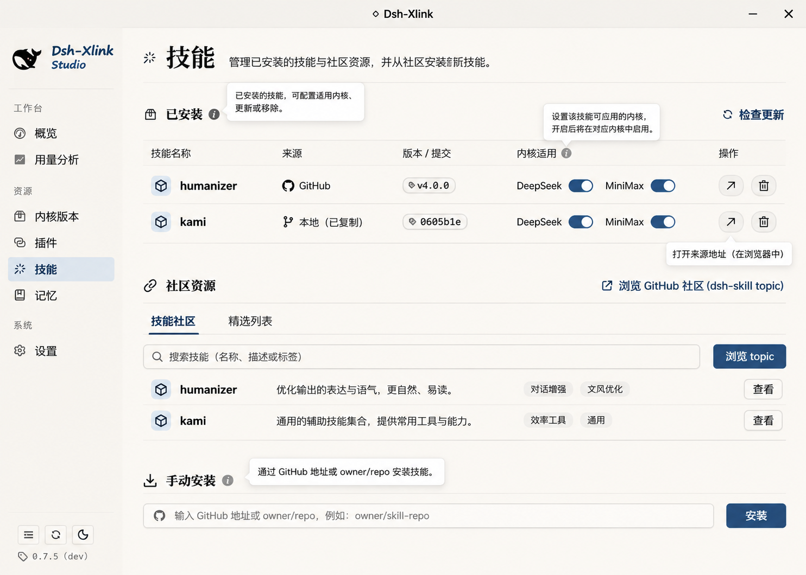
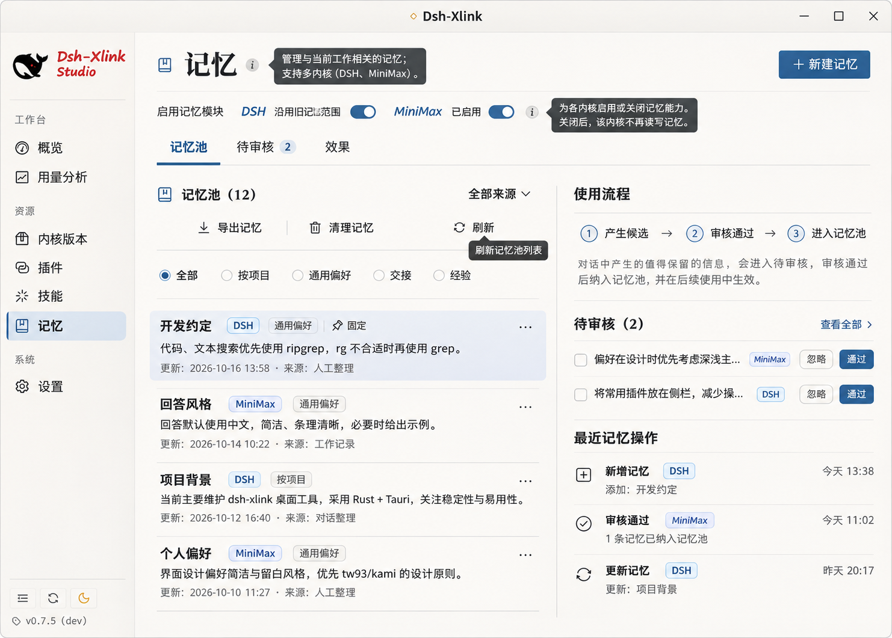
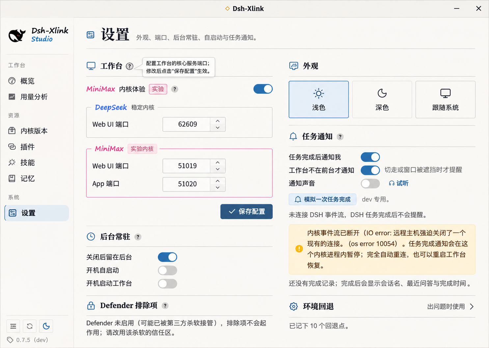

# 概念图及必须修正的差异

七张图均为本次讨论生成的视觉概念，已按原始 PNG 复制，不是产品运行截图，不是暗色验收证据。尺寸与 SHA-256 见 [references.json](references.json)。图中的账号额度、模型、记忆内容、版本、端口、时间、状态全部是示例，不能作为真实功能或测试期望。

请先阅读 [实施方案](README.md)；发生冲突时按文字合同与真实代码实现。所有图里大段页面说明改为ⓘ，错误/风险/许可仍按方案常驻。图中明亮蓝色以 tokens.json 的墨蓝替换，不靠取样追色。

## 概览

保留暖纸、首行两列、整宽今日用量与细分隔。图中的「已停止」与「运行中」同时出现、运行中还有「启动」按钮是矛盾，不得实现。底部活动流内容与分类没有对应当前 API，继续使用真实的需要关注/最近操作。

## 用量分析

保留厂商横向行与上下两段。不能照抄余额、百分比、厂商清单、刷新时间；下方未画到的趋势/模型/外部来源表仍须完整保留。Codex 登录许可与外部工具统计许可不是一项；外部勾选默认不擅自打开。

## 内核版本

保留版本两组与四类磁盘分布。推荐徽标须有真实来源，否则不显示；统计是整个壳，不随 family 过滤，图里示例数字没有算术/统计口径保证。磁盘树只读。

## 插件

此图最需要纠正：

- 内置与自装必须同列表，只给内置徽标，删除底部自装分区和空框。
- OpenAI、官网对话引用尚未适配 MiniMax，不能画可用空框。记忆的 MiniMax 状态为只读许可镜像。
- 删除安装行的双目标勾选，当前没有这个批量安装契约。
- Ponytail 不是模型代理；官网对话引用不是官网文档搜索。具体用途按后端 summary 与方案 §7。
- 自装 DeepSeek 当前是只读已安装，不可取消勾选实现卸载或伪停用。
- 侧栏品牌、鲸标与原色取本地现有资源，不按此图重画。

## 技能

保留清晰列与内核适用控件。删除搜索框、精选列表、社区结果及标签，当前只有 GitHub topic 外链。每个包可能有多个技能，必须逐技能控件，不能每包只画一对。MiniMax 不是勾选后即时运行生效。

## 记忆

启用行 DSH 显示为 DeepSeek；图中普通记忆文案不作为产品 seed 数据。导出与清空必须保留当前 DSH 范围，不能扩成全池。图中右侧「最近记忆操作」无对应完整事件源，保留真实最近注入/提取任务/检索预览/效果能力。MiniMax 自动提取未接入，不把流程图宣传为两核自动闭环。

## 设置

保留 MiniMax 粉色端口组、两列分区和外观三选一。端口不硬编码；固定后台常驻不改成可开关；dev 模拟通知不出现在 release。Defender 仅 Windows，相关风险告知不能因精简文案删掉。侧栏品牌仍按真实鲸眼红规则。
