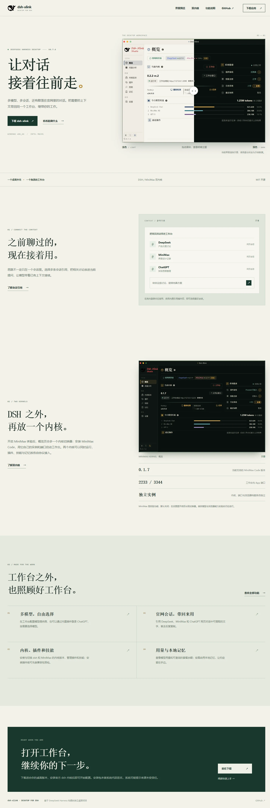
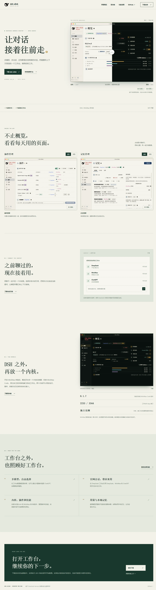
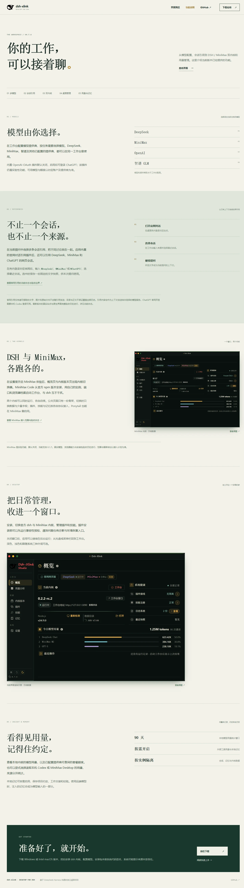
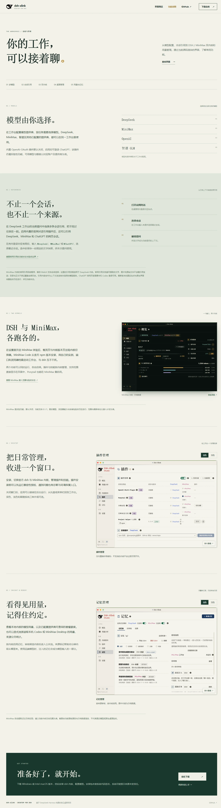

# 官网界面更新与前后对比

基线：`ccb6250f8cc6f35ac9611d45441b15788d8c3329`（2026-11-13）。

## 关键修改

- 重拍概览与 MiniMax 截图，新增插件、记忆的明暗主题截图，共七张。
- 首页展示实际功能页，主题按钮同步原图链接；支持原图放大、Escape 关闭与焦点恢复，无 JavaScript 时仍可打开原图。
- 功能页使用对应页面截图，明确 MiniMax 官网引用暂停和自动记忆提取尚未接入。
- 去掉易过时的固定版本展示，保留当前源码与发布包可能不同的边界说明。

## 前后对比

| 页面 | 修改前 | 修改后 |
| --- | --- | --- |
| 首页 |  |  |
| 功能说明 |  |  |

移动端：[首页](site-after-mobile.webp) · [功能说明](features-after-mobile.webp)。

## 来源与验证边界

应用图片来自真实 Vue 前端，使用公开虚构桥响应、插件和记忆样例；没有读取用户账户、会话或记忆数据。Windows Edge 模拟 macOS 外观，不是 macOS 原生截图，也不代表真实模型、插件或桌面后端验收。复现步骤见 [截图脚本](../../scripts/website-preview/README.md)。

Windows Edge 上已检查网站 375、768、1440 CSS 像素宽度，无横向溢出，所有图片加载；明暗切换、原图链接、放大、Escape、焦点和滚动恢复通过。网站单元测试 5/5、前端截图构建、不变量与重复代码检查通过。未做 macOS 原生验收或真实模型请求。
